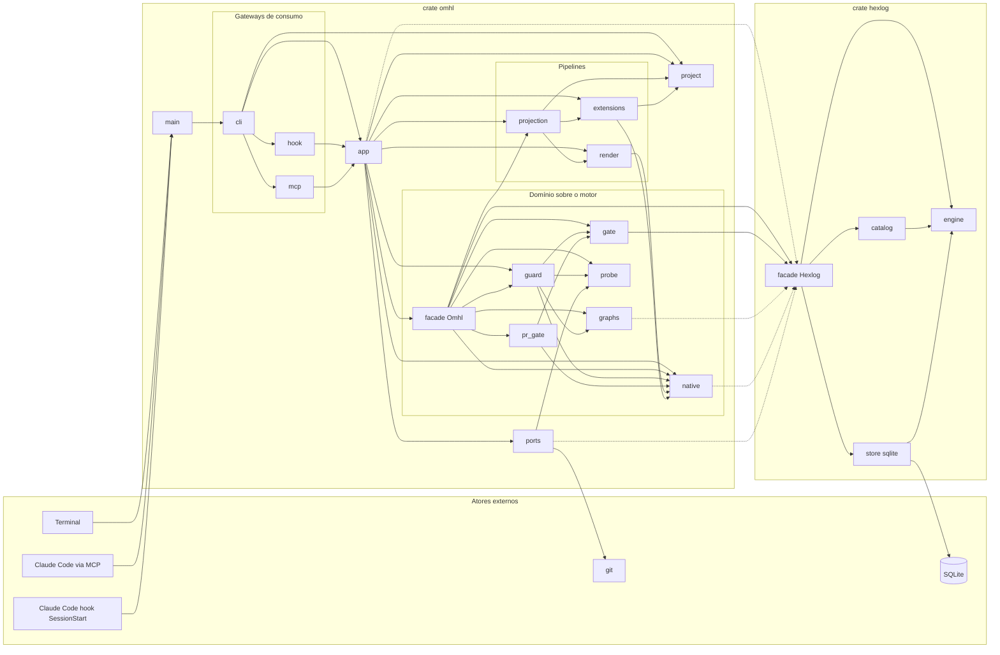

# Arquitetura: caixas cinzas do oh-my-hexflow

Análise do código produzido nos passos 3 a 6 (`crates/hexlog/src` e `crates/omhl/src`, cerca de 11,6 mil linhas de código e 2,2 mil de testes embutidos). Segue a decisão de projeto sobre caixas cinzas: caixa cinza é um módulo profundo, de interface pequena e interior delegável ao agente, aninhável. Os limites abaixo saíram do código e dos testes de arquitetura, não de um desenho prévio. Vocabulário: **module**, **interface**, **depth**, **seam**, **adapter** como na skill `codebase-design`; termos de domínio como em `GLOSSARY.md`. "Interface" inclui invariantes e ordem de chamada, não só a assinatura.

## 1. Diagrama

Setas apontam de quem depende para quem é dependido. Setas pontilhadas são uso só de tipos de dado ou implementação de uma port.

Notas de leitura:

- `app -> hxfacade` (pontilhada) cobre 12 arquivos de `app` que importam tipos do `hexlog`; os adapters não importam nenhum (travado, seção 4).
- `projection -> extensions` existe só por um helper de filesystem (`extensions::files`); é um dos pontos da seção 5.
- `projection`, `extensions` e `render` também tomam tipos de dado do `hexlog` (`NodeView`, `SemanticId`); omitido do diagrama.
- O SQLite só é tocado por `store sqlite`: o `omhl` não declara `sqlx` nem `rusqlite` (travado, seção 4).

## 2. Contexto em um parágrafo

O workspace tem dois crates. O `hexlog` é o motor agnóstico: guarda a chain de records por tenant num SQLite, valida contra um catalog dado por quem o abre e não conhece decisão, check, gate nem PRD. O `omhl` é o plugin opinativo: monta o catalog dos graphs, embute o native, guarda as regras de domínio na escrita, avalia gates, renderiza o contexto, carrega extensions e gera a projection, e expõe tudo por três gateways (CLI, MCP, hook) que dividem uma única camada de casos de uso (`app`). A separação não é só convenção: oito testes de arquitetura a travam (seção 4).

## 3. Caixas cinzas

Resumo (linhas de `src` sem `tests.rs` embutido; interface = pontos que um chamador precisa conhecer):

| Caixa | Linhas | Interface (ponto de entrada) | Profundidade |
|---|---|---|---|
| `hexlog` | 5.490 | 10 operações em `Hexlog` + 58 nomes exportados | funda |
| `hexlog::engine` | 2.507 | `decide`, `verify_chain`, `instant_is_well_formed` | funda |
| `hexlog::catalog` | 1.149 | `Catalog::new` + 5 consultas | funda |
| `hexlog::store` | 932 | `Store` (3 métodos) | funda, seam de 1 adapter |
| `omhl::facade` (`Omhl`) | 235 | 13 operações | média |
| `omhl::gate` | 352 | `evaluate`, `read_consistent`, `GateSource` | funda |
| `omhl::guard` | 390 | `check_append`, `check_question_filters`, `check_where_eq`, `probe_refusal`, `attestation_id` | funda |
| `omhl::pr_gate` | 154 | `required_checks`, `pr_gate_questions` | média |
| `omhl::graphs` | 46 + 6,4 kB JSON | `catalog()`, `WORK_ITEM_TYPES` | funda como função, rasa como vocabulário |
| `omhl::native` | 104 | `NativeBase` | dado (folha) |
| `omhl::app` | 1.735 | `App`, `Runtime`, `run_action`, `Action`, `Caller` | funda, com fuga de contrato |
| `omhl::adapters` | 713 | `cli::run`, `mcp::serve`, `hook::session_start` | funda por adapter |
| `omhl::extensions` | 872 | `collect`, `plan` | funda |
| `omhl::projection` | 569 | `build`, `write` | funda |
| `omhl::render` | 297 | `render` | funda |
| `omhl::ports` | 250 | `SystemClock`, `V7Ids`, `GitProbe` | adapters |
| `omhl::project` | 282 | `find_marker`, `default_db_path`, `prepare_db_file`, `Env` | rasa |

### 3.1 Núcleo: `hexlog` (facade `Hexlog`)

**Papel.** Guarda e consulta a chain de records de cada tenant num SQLite, com escrita atômica em batch, idempotência e verificação de hash.

**Interface pública real.** `crates/hexlog/src/lib.rs` exporta 58 nomes: 52 tipos de dado e ids e 6 funções de `chain`. As operações são 10 métodos de `Hexlog<'d>` (`crates/hexlog/src/facade.rs`): `open`, `ensure_tenant`, `append`, `get`, `lineage_records`, `list`, `relations`, `chain_head`, `verify_chain`, `catalog`. Entradas e saídas: `Config` (com `Limits` e `VerifyPolicy`), `Deps` (`clock`, `ids`, `catalog`, `native`), `AppendRequest`/`AppendOutcome`, `NodeView`, `RevisionView`, `RelationView`, `Page`, `TenantInfo`, `ChainHead`, `ChainReport`, `HexlogError`/`ErrorCode`. Ports que o chamador implementa: `Clock`, `IdGenerator`, `NativeNodes` (`crates/hexlog/src/engine/ports.rs`). Invariantes que o chamador precisa saber: `&mut self` em tudo (um usuário por instância); `Busy` quando passa o `busy_timeout`; com `VerifyPolicy::Full` toda operação verifica a chain antes.

**Escondido.** A ordem de recusa da escrita, a política de replay por chave de idempotência, a verificação de ciclo (`acyclic`), a montagem do hash encadeado, a transação `BEGIN IMMEDIATE`, o `block_on` do `sqlx`, o esquema SQL. O `omhl` não importa `sqlx` nem `rusqlite`.

**Caixas aninhadas.** `engine`, `catalog`, `store` (3.2 a 3.4), todas privadas em `lib.rs` (`mod engine; mod catalog; mod store;`).

**Profundidade.** Funda. 10 operações e tipos de dado sobre 5,5 mil linhas, com o chamador sem nenhum conhecimento de SQL, hash ou transação. Seams reais (mais de um adapter): `Clock`, `IdGenerator`, `NativeNodes`, cada um com adapter de produção em `omhl` (`SystemClock`, `V7Ids`, `NativeBase`) e fake nos testes (`FixedClock`, `SeqIds`, `FakeNative` em `crates/hexlog/tests/support/mod.rs`).

### 3.2 Aninhada: `hexlog::engine`

**Papel.** Decide se um batch pode entrar na chain e prova se a chain está íntegra, sem saber de onde vêm os dados.

**Interface.** Visível só para a facade: `decide(&DecideCtx, &AppendRequest, &mut dyn WriteReads) -> Result<AppendPlan, HexlogError>` (`engine/decide.rs:34`), `DecideCtx` (`:25`), `verify_chain(&mut dyn VerifyReads, &TenantId, Option<&Hash>) -> Result<ChainReport, HexlogError>` (`engine/verify.rs:97`), `instant_is_well_formed` (`engine/rules.rs:17`). Ports internas: `Store`, `WriteReads`, `QueryReads`, `VerifyReads`, `StoreReader`, `Definitions` (`engine/ports.rs`).

**Escondido.** Os seis passos de `decide` (forma, tenant, replay, regras estáticas, cauda, histórico, montagem), `chain.rs` (JCS, `hash_record`, `fingerprint`), `limits.rs`, `rules.rs`, `model.rs` (corpo do record).

**Profundidade.** Funda: 3 pontos de entrada sobre 2,5 mil linhas. As ports `Store`/`WriteReads`/`QueryReads`/`VerifyReads`/`Definitions` têm um adapter cada (`SqliteStore`/`Tx` em `store/sqlite`, `Catalog` em `catalog/types.rs:251`): seam hipotético pela régua da skill. Ele se paga porque é o que o teste `it_should_not_import_store_or_catalog_from_the_engine_sources` usa para manter o engine sem SQL (seção 4); os testes de integração do hexlog usam o SQLite real.

### 3.3 Aninhada: `hexlog::catalog`

**Papel.** Compila e valida as definições de tipos de node e relation types, e valida o `data` de cada node contra o schema do tipo.

**Interface.** `Catalog::new(Vec<TypeDef>, Vec<RelationTypeDef>) -> Result<Catalog, HexlogError>` (`catalog/types.rs:159`), `type_def`, `relation_type_def`, `type_hash`, `relation_type_hash`, `validate_data` (`:226-243`), mais `TypeDef`, `RelationTypeDef`.

**Escondido.** Compilador de JSON Schema 2020-12 (`catalog/validate.rs`, 882 linhas: `CompiledSchema`, `compile`), grafo de relations com `petgraph`, hash das definições (`def_hash`) que o record grava.

**Profundidade.** Funda: 6 chamadas sobre 1,1 mil linhas, e o `omhl` obtém um catalog inteiro validado numa chamada (`graphs::catalog`).

### 3.4 Aninhada: `hexlog::store`

**Papel.** Persiste records, tenants e batches no SQLite, e é o único lugar que sabe de SQL e de `block_on`.

**Interface.** `trait Store` (`ensure_tenant`, `append_with`, `read`) em `engine/ports.rs`; `SqliteStore::open` em `store/sqlite/mod.rs`.

**Escondido.** `ddl.rs` e `schema.sql`, `Tx` (`tx.rs`, 708 linhas, implementa as três portas de leitura), reconexão depois de falha, `futures_executor::block_on`.

**Profundidade.** Funda no que esconde, com um adapter só (seam hipotético, ver 3.2).

### 3.5 Núcleo do domínio: `omhl::facade` (`Omhl`)

**Papel.** É o `Hexlog` com as regras do plugin: guarda de escrita, gates, fechamento de work item e leitura para a projection.

**Interface.** `Omhl<'d>` (`crates/omhl/src/facade.rs`): `open`, `ensure_tenant`, `append`, `get`, `lineage_records`, `list`, `relations`, `chain_head`, `verify_chain`, `evaluate`, `evaluate_pr_gate`, `read_projection_state`, `close_work_item`. Entradas: `OmhlDeps` (`clock`, `ids`, `probe`), `ClosedWorkItem`, `GateQuestion`, `GateReport`. Invariante: `append` só grava depois da guarda validar o batch inteiro; `close_work_item` grava direto, sem a guarda, e exige snapshot de árvore limpa.

**Escondido.** Montagem do catalog (`graphs::catalog`), do `NativeBase` estático, leitura do gate entre duas leituras iguais do chain head (`read_consistent`), a regra de que o gate reprovado ainda fecha.

**Aninhadas.** `guard`, `gate`, `pr_gate`, `graphs`, `native`, `probe`.

**Profundidade.** Média. Das 13 operações, 6 só repassam ao `Hexlog` (`ensure_tenant`, `get`, `lineage_records`, `relations`, `chain_head`, `verify_chain`: `facade.rs:69,80,89,108,116,120`). O valor está em 5: `append`, `list` (com guarda), `evaluate`, `evaluate_pr_gate`, `close_work_item`. Pelo teste da exclusão, sumir com a facade espalharia a guarda e o gate por todos os chamadores; é por isso que ela existe, mas ela é mais larga do que funda.

### 3.6 Aninhada: `omhl::gate`

**Papel.** Avalia perguntas sobre o histórico de um tenant e diz se o gate passa, sem conhecer nenhum tipo do domínio.

**Interface.** `evaluate`, `read_consistent`, `trait GateSource` (`chain_head`, `nodes`, `relations`), `Question` (`Approved`, `Occurred`, `NoPending`, `NoOpenContradiction`), `GateQuestion`, `QuestionReport`, `GateReport::assemble`, `HexlogSource` (`gate/mod.rs`, `gate/source.rs`).

**Escondido.** A semântica de cada pergunta, o corte de evidência (`EVIDENCE_CAP`), a paginação de `HexlogSource::nodes`.

**Profundidade.** Funda. Seam real: dois adapters de `GateSource` (`HexlogSource` e `FakeSource` em `crates/omhl/tests/support/gate.rs`). Travado: o gate não importa `native`, `graphs` nem `pr_gate` e não contém os literais `check`, `work-item`, `attestation`.

### 3.7 Aninhada: `omhl::guard`

**Papel.** Recusa antes da escrita o que as regras do plugin proíbem: id fora do namespace do tipo, fechar work item fora de `close_work_item`, reativar o que foi retirado, atestado sem snapshot reproduzível.

**Interface.** `check_append(&mut Hexlog, &dyn SnapshotProbe, &AppendRequest)`, `check_question_filters`, `check_where_eq`, `probe_refusal` (todas `pub(crate)`, `guard/mod.rs:7-9`), `attestation_id` e `WHERE_EQ_PAIRS_MAX`, `WHERE_EQ_TEXT_MAX` (públicos).

**Escondido.** `Guard` e `NodeItem` (`guard/append.rs`), a regra de atestado (`guard/attestation.rs`), os filtros (`guard/filter.rs`), a sonda lida uma vez por batch (`probe_once`).

**Profundidade.** Funda no comportamento: uma chamada valida o batch. É também o maior consumidor do vocabulário de tipos (seção 5, item 1).

### 3.8 Aninhada: `omhl::pr_gate`

**Papel.** Define o gate do pull request: quais checks são obrigatórios e que perguntas fazer.

**Interface.** `required_checks`, `pr_gate_questions`, `GATE_NAME`, `REQUIRED_EVENTS`, e `project_checks_filter`, `closing_request` (`pub(crate)`) em `pr_gate.rs`.

**Profundidade.** Média: política em forma de função. Interface e interior têm tamanho parecido (154 linhas, 4 funções); é aceitável porque é a tabela de política do plugin e muda por motivo próprio.

### 3.9 Aninhada: `omhl::graphs`

**Papel.** Entrega o catalog dos três graphs (decisões, checks, work items) como dado.

**Interface.** `catalog() -> Result<Catalog, HexlogError>` e `WORK_ITEM_TYPES` (`graphs/mod.rs:5,14`).

**Escondido.** Os três `catalog.json` (6,4 kB) embutidos por `include_str!` e a leitura; a validação fica no `Catalog::new` do hexlog.

**Profundidade.** Funda como função. Rasa como dono do vocabulário de tipos: só `WORK_ITEM_TYPES` é compartilhado (item 1 da seção 5).

### 3.10 Aninhada (folha): `omhl::native` e `omhl::probe`

- `native`: `NativeBase` (`checks()`, `guidelines()`, impl de `NativeNodes`), `NativeCheck`, `NativeGuideline`, `NATIVE_CATALOG_VERSION` (`native/mod.rs`). Folha travada: não importa `gate`, `facade`, `guard`, `pr_gate`. Não é módulo profundo: é dado versionado com o plugin (decisão 16).
- `probe`: `trait SnapshotProbe` (um método `probe`), `ProbeOutcome`, `ProbeError` (`probe.rs`, 17 linhas). É só o seam; adapters: `GitProbe` e `FakeProbe` (`crates/omhl/tests/support/mod.rs`). Seam real.

### 3.11 Gateway de consumo: `omhl::app`

**Papel.** É o caso de uso: transforma uma `Action` de qualquer gateway numa chamada ao `Omhl` e devolve JSON, com repetição de `Busy`.

**Interface.** `App::open`, `App::with_project_root`, `App::dispatch(&Caller, &Action) -> Result<Value, AppError>` (`app/mod.rs`); `Runtime::discover`, `Runtime::app`, `run_action` (`app/runtime.rs`); `Action` (10 variantes), `Caller::{cli, mcp, hook, loader}`, `parse_tool_call` (`app/action.rs`); `read_json_input`, `parse_json_text`, `INPUT_MAX_BYTES` (`app/input.rs`); `RetryPolicy` (`app/retry.rs`); `AppError::{code, message, to_json}` (`app/error.rs`); `output::{node, page, appended, gate, closed, verify}`. Invariantes: `load` e `project` respondem `no-project-root` sem `with_project_root`; só `Busy` é repetido (nada foi gravado nesse caso).

**Escondido.** `Engine` (`app/engine.rs`) que despacha cada ação; `attest` (`app/attest.rs`), `load` (`app/load.rs`), `context` (`app/context.rs`), `wire` (`app/wire.rs`: JSON para `AppendRequest`), `read` (`app/read.rs`), a tradução de erros do motor, do domínio e do projeto para um `AppError`.

**Aninhadas.** `extensions`, `projection`, `render` (3.13 a 3.15) são orquestradas por `Engine`.

**Profundidade.** Funda no uso (3 adapters passam por 3 funções), com a fuga de contrato descrita nos itens 2, 5 e 6 da seção 5. É onde o contexto mais cresceu em `omhl`: 1.735 linhas, o maior módulo.

### 3.12 Gateway de consumo: `omhl::adapters`

**Papel.** Traduz um protocolo externo (linha de comando, JSON-RPC por stdio, evento de hook) em `Action` e imprime o resultado; não conhece o domínio.

**Interface.** `cli::run(args, stdin, out, err, env) -> ExitCode` (com os tipos clap `Cli`, `Command`, `ActionCommand`, `HookEvent`), `mcp::serve(input, out, start, db, env) -> ExitCode`, `hook::session_start(stdin, out, err, env) -> ExitCode`. `main.rs` (20 linhas) só monta o `Env` e chama `cli::run`.

**Escondido.** Em `mcp.rs` (370 linhas): framing por linha com teto de 1 MiB, duas gerações do protocolo (`Era::Modern`, `Era::Legacy`), schemas das ferramentas (`read_tools`, `write_tools`, `plain_tools`, `extension_tools`), cache. Em `hook.rs`: a saída `hookSpecificOutput` e o aviso de extensions (só códigos e contagens).

**Profundidade.** Funda por adapter: uma função cada. Importam só `app` e `project::Env` (verificado), e o teste `it_should_keep_adapters_free_of_hexlog_imports` impede o resto.

### 3.13 Aninhada: `omhl::extensions`

**Papel.** Lê as extensions TOML de `.omhl/`, valida e calcula o que mudaria no tenant, sem gravar nada.

**Interface.** `collect(&Path) -> Collected` (`extensions/collect.rs`), `plan(&PlanInput) -> Result<Plan, Vec<ExtensionIssue>>` (`extensions/plan.rs:90`), tipos `Extension`, `ExtensionKind`, `ExtensionIssue`, `ExistingNode`, `ExistingRelation`, `PlannedChange`.

**Escondido.** `scan` (limites de diretório e arquivo), `parse` (TOML estrito, caracteres invisíveis), reserva de ids nativos, reconciliação com orphans e relations. `scan` e `parse` também são públicos, mas só `collect` os usa.

**Profundidade.** Funda: 2 entradas sobre 872 linhas, pipeline puro (travado: não importa `adapters`, `app`, `facade`).

### 3.14 Aninhada: `omhl::projection`

**Papel.** Gera os arquivos de leitura de `.omhl/projection/` a partir do estado vigente.

**Interface.** `build(&ProjectionState) -> Result<Vec<ProjectedFile>, ProjectionError>` (`projection/build.rs:26`), `write(&Path, &[ProjectedFile]) -> Result<WriteReport, ProjectionError>` (`projection/write.rs:17`), `ProjectionState`, `WriteReport`.

**Escondido.** Agrupamento por work item, truncamento, lock de diretório, arquivos temporários, substituição atômica só do que mudou, remoção de orphans gerados, `.gitignore` da pasta.

**Profundidade.** Funda. O seam entre `build` (puro) e `write` (IO) deixa a montagem testável sem filesystem (`tests/projection_build.rs`, `tests/projection_write.rs`). `tempfile` só entra aqui (travado).

### 3.15 Aninhada: `omhl::render`

**Papel.** Monta o texto de contexto injetado no `SessionStart`, dentro de um orçamento de bytes.

**Interface.** `render(&RenderInput, usize) -> Rendered`, `CONTEXT_BUDGET`, `RenderInput` (`render.rs:12,28`).

**Escondido.** Ordem das seções, corte por orçamento em pontos de nó, escape de valores.

**Profundidade.** Funda e pura: uma função sobre 297 linhas.

### 3.16 Suporte: `omhl::ports` e `omhl::project`

- `ports`: adapters de produção. `SystemClock` (`impl Clock`), `V7Ids` (`impl IdGenerator`), `GitProbe::{new, with_program, with_timeout}` (`impl SnapshotProbe`, executa o `git` com timeout), `format_system_time`, `format_utc`. Adapters finos de seam real.
- `project`: descoberta do projeto. `find_marker`, `parse_marker`, `Marker`, `Located` (`project/marker.rs`), `default_db_path`, `prepare_db_file` (`project/paths.rs`), `Env`, `ProjectError` (`project/mod.rs`), 13 constantes em `project/layout.rs`, helpers de texto em `project/text.rs`. Rasa: metade é lista de constantes e helpers compartilhados por `extensions` e `projection` (item 7 da seção 5).

## 4. Regras de dependência e o teste que trava cada uma

### `hexlog` (`crates/hexlog/tests/architecture.rs`)

| Regra | Teste |
|---|---|
| O `engine` não importa `store` nem `catalog` (nem `use crate::*`) | `it_should_not_import_store_or_catalog_from_the_engine_sources` |
| `engine`, `catalog`, `store` são privados em `lib.rs`; cada filho do `engine` tem a visibilidade exata da lista `ENGINE_CHILDREN` | `it_should_declare_every_engine_child_module_with_restricted_visibility` |
| Nenhum identificador, literal ou SQL usa vocabulário de domínio (`decision`, `check`, `gate`, `claude`, `omhl` e afins) | `it_should_not_use_domain_vocabulary_in_identifiers_or_string_literals_of_the_hexlog_sources` (o varredor é provado por `it_should_flag_forbidden_words_in_identifiers_and_literals_and_ignore_them_in_comments_and_sql_keywords`) |
| `git` só aparece em `engine/snapshot.rs` | `it_should_mention_git_only_in_engine_snapshot` |
| `block_on` e `futures_executor` só em `store/sqlite` | `it_should_confine_block_on_to_the_sqlite_store` |
| Sem runtime assíncrono, cliente HTTP nem biblioteca git no fecho de dependências | `it_should_not_depend_on_forbidden_crates` |
| O `hexlog` não depende do `omhl` | `it_should_not_depend_on_omhl` |
| Testes de integração só usam a API pública | `it_should_keep_integration_tests_on_the_public_api` |
| Lints de memória do workspace herdados e sem `allow` | `it_should_inherit_the_workspace_lints_in_every_crate`, `it_should_refuse_allow_for_the_memory_lints_and_require_a_registered_reason_on_expect` |

### `omhl` (`crates/omhl/tests/architecture.rs`)

| Regra | Teste |
|---|---|
| `main.rs` até 30 linhas e sem `hexlog::` | `it_should_keep_main_free_of_domain_logic_and_hexlog_paths` |
| `native` é folha: sem `gate`, `facade`, `guard`, `pr_gate`, `omhl::` | `it_should_keep_the_native_sources_free_of_gate_facade_guard_and_pr_gate_imports` |
| `gate` é agnóstico: sem `native`, `graphs`, `pr_gate` e sem os literais `check`, `work-item`, `attestation` | `it_should_keep_the_gate_sources_free_of_domain_names_and_native_imports` |
| `adapters` não importam o `hexlog` | `it_should_keep_adapters_free_of_hexlog_imports` |
| `app`, `render`, `project`, `ports` não importam `adapters` | `it_should_not_import_adapters_from_the_inner_layers` |
| `extensions` e `projection` não importam `adapters`, `app`, `facade` | `it_should_not_import_adapters_app_or_facade_in_extensions_and_projection` |
| `tempfile` só em `projection/write.rs` | `it_should_use_tempfile_only_in_projection_write` |
| Dependências diretas exatas (`clap`, `hexlog`, `serde`, `serde_json`, `tempfile`, `toml`, `uuid`): o SQLite só chega por `hexlog` | `it_should_declare_exactly_the_expected_direct_dependencies` |
| Sem async, HTTP, `git2`, `gix*` e `serde_yaml` no lockfile | `it_should_keep_forbidden_crates_out_of_the_lockfile` |
| Nenhuma escrita em stdout nos fontes (a saída vai pelo `out` recebido) | `it_should_keep_stdout_writes_out_of_every_source_file` |
| Sem atômicos em `src` | `it_should_not_use_atomics_anywhere_in_src` |
| O hook não procura o marcador duas vezes | `it_should_not_search_the_marker_twice_in_the_hook` |

### Regras que valem hoje no código mas sem teste

- No `hexlog`: `store` e `catalog` não importam um ao outro, e só a facade os compõe. É verdade hoje (verificado nos imports), mas só a regra `engine -> store/catalog` está travada.
- No `omhl`: a lista de camadas internas que não podem importar `adapters` omite `facade`, `guard`, `gate`, `graphs`, `pr_gate`, `probe`; hoje nenhum o faz. Também não há trava para o conjunto que `app` pode importar (`facade`, `extensions`, `projection`, `render`, `native`, `guard`, `ports`, `project`, `probe`, `gate`) nem para o que os adapters podem importar além do `hexlog` (hoje só `app` e `project`).

## 5. Pontos rasos ou com vazamento

Oito itens, em ordem de valor. "Corte" é o que recomendo fazer; "dívida" é o que aceito até haver motivo.

1. **Vocabulário de tipos espalhado (corte).** Os nomes `work-item`, `pull-request`, `premise`, `decision`, `guideline`, `attestation` são strings soltas em `facade.rs:22-28` (`PROJECTED_NODE_TYPES`), `projection/build.rs:59-61` (`is_work_item`) e `:17-22` (`SECTIONS`), `guard/append.rs:15-19` (`namespace_of`) e `:121-126` (`check_node`), `pr_gate.rs:71,84`, `app/context.rs:15-18`, `app/attest.rs:13`. Só `WORK_ITEM_TYPES` (`graphs/mod.rs:5`) é compartilhado, e `projection/build.rs` não o usa. Trocar o nome de um tipo exige caçar seis arquivos. Corte: `graphs` exporta as constantes (tipos de work item, tipos projetados, namespace por tipo). Trade-off: `graphs` ganha interface; em troca vira o único dono do vocabulário, que o `gate` já prova que dá para isolar.

2. **`app` entra no domínio por mais de uma porta (corte barato, decisão sua no segundo passo).** `app/attest.rs:9` chama `guard::attestation_id`, `app/engine.rs:14` chama `projection::{build, write}`, `app/load.rs:1,11-17` chama `hexlog::chain::fingerprint`, `extensions::{collect, plan}` e `NativeBase`, e `app/context.rs` lê `NativeBase` direto. Enquanto isso, 6 das 13 operações de `Omhl` só repassam (`facade.rs:69,80,89,108,116,120`). Nada trava o que `app` pode importar (seção 4). Corte barato: um teste que fixe o conjunto permitido de `app`. Corte maior, só se valer: mover a montagem do atestado para dentro de `Omhl`, o que acrescenta uma operação à facade e tira o conhecimento de `guard` de `app`.

3. **Paginação e constantes duplicadas (corte).** O laço de páginas existe em `app/read.rs:all_nodes` (`PAGE_LIMIT = 50`, `:6`) e em `gate/source.rs:HexlogSource::nodes` (usa `config.limits.page_default`, `facade.rs:65`), e `app/engine.rs:17` tem um terceiro `DEFAULT_PAGE_LIMIT = 50`. A relation `after` aparece como constante em `app/context.rs:10` e `app/load.rs:21` e como literal em `native/mod.rs:88`. Corte: `Omhl` expõe uma leitura de todos os nodes de um tipo reaproveitando `HexlogSource`. Trade-off: uma operação a mais na facade (a 14ª), em troca de um só laço.

4. **A sonda do git vive em duas camadas (dívida).** `Engine` guarda o `probe` (`app/mod.rs`, campo `probe: deps.probe`; `app/engine.rs:probe_snapshot`) e `Omhl` guarda outro (`facade.rs:46-50`, usado em `:75` e `:215`). Em `close`, `Engine::close` sonda e `close_work_item` sonda de novo (`facade.rs:215`): dois `git` por fechamento, e a segunda leitura é a que vale. Aceitável porque `evaluate_pr_gate(tenant, work_item, &snapshot)` recebe o snapshot explícito, o que o `tests/pr_gate.rs` aproveita. Vira corte se aparecer um caso em que as duas leituras discordem.

5. **Vocabulário do MCP dentro de `app` (corte).** `parse_tool_call` (`app/action.rs:86`) conhece os nomes das ferramentas MCP, e só `adapters/mcp.rs:7,177` o usa (nenhum teste). Os schemas das ferramentas estão em `mcp.rs` (`tools()`). Acrescentar uma ação toca 6 pontos: `Action` (`action.rs`), `parse_tool_call`, `Engine::run`, `ActionCommand` e `to_action` (`cli.rs`), `tools()` (`mcp.rs`). Corte: mover `parse_tool_call` para `adapters/mcp.rs`; a direção `adapters -> app` se mantém. Trade-off: nenhum relevante; é só mover.

6. **Contrato de saída sem tipo (dívida).** `App::dispatch` devolve `Result<Value, AppError>` e o hook decodifica por chave de string: `pending_note` lê `created`, `revised`, `relations_created`, `tenant`; `context_for_session` compara com `"no-marker"`; `warning` compara com `"extensions-invalid"` (`adapters/hook.rs`). As chaves nascem em `app/load.rs`. Hoje só o teste `tests/hook.rs` pega uma divergência. Aceitável porque CLI, MCP e hook compartilham um único formato JSON de propósito; vira corte (um `LoadReport` tipado em `app`) quando um segundo consumidor ler o mesmo relatório.

7. **Helpers no lugar errado (corte pequeno).** `projection/write.rs` importa `extensions::files::list_sorted_capped`, `projection/build.rs` importa `render::sort_by_id`, e `project/layout.rs` mistura constantes de `extensions` (`EXT_FILE_MAX_BYTES`, `CHECKS_DIR`), de `projection` (`PROJECTION_*`) e de arquivo temporário (`TMP_*`). O teste de pureza só proíbe `adapters`/`app`/`facade`, não o acoplamento `projection -> extensions`. Corte: `extensions/files.rs` e `render::sort_by_id` vão para `project` (que já hospeda `text.rs`).

8. **Superfície pública do `hexlog` maior que o consumo (dívida consciente).** `lib.rs:25-29` exporta 6 funções de `chain` e o `omhl` usa só `fingerprint` (`app/load.rs:1`); `CHECKED_FIELDS` (`lib.rs:9`) só serve a `tests/chain_tamper.rs`; `Hexlog::catalog` (`facade.rs:331`) não tem chamador no workspace. A causa é a regra de que os testes de integração usem só a API pública (`it_should_keep_integration_tests_on_the_public_api`): o que os testes de adulteração precisam vira público. Cortar exige uma feature de cargo para test support. Também é o único conhecimento de host dentro do motor: `SnapshotKind::GitCommit` (`engine/snapshot.rs:8-10`), assumido e travado por `it_should_mention_git_only_in_engine_snapshot`.
