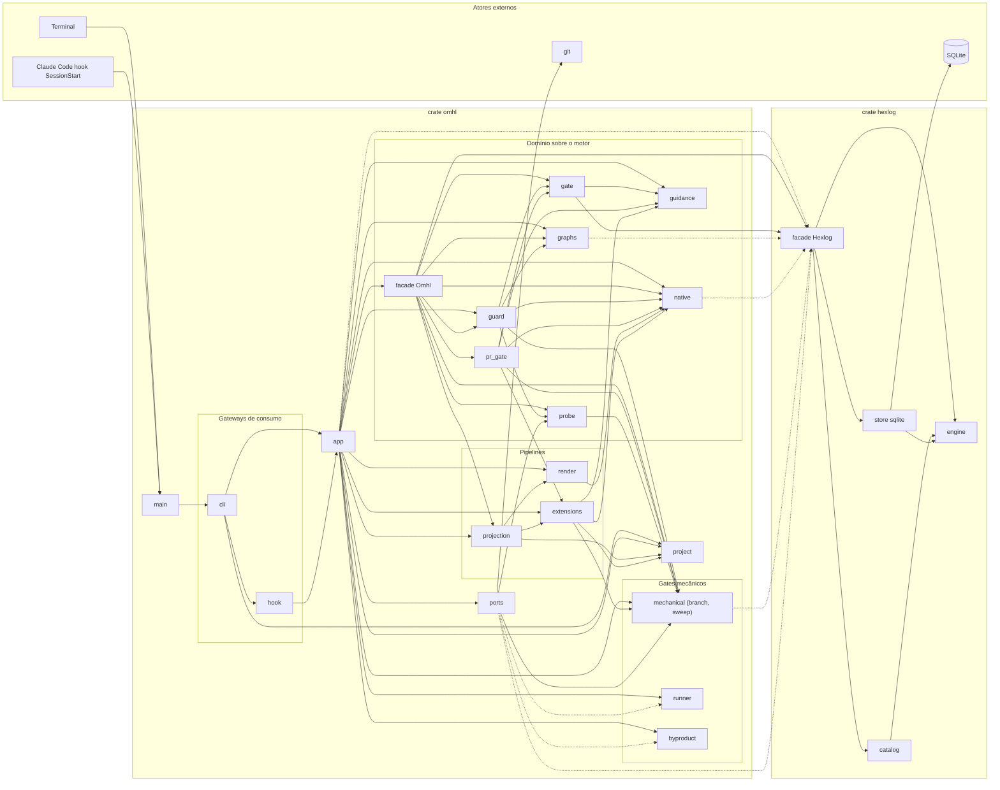

# Arquitetura: caixas cinzas do oh-my-hexflow

Análise do código produzido nos passos 3 a 6 (`crates/hexlog/src` e `crates/omhl/src`, cerca de 11,6 mil linhas de código e 2,2 mil de testes embutidos). Segue a decisão de projeto sobre caixas cinzas: caixa cinza é um módulo profundo, de interface pequena e interior delegável ao agente, aninhável. Os limites abaixo saíram do código e dos testes de arquitetura, não de um desenho prévio. Vocabulário: **module**, **interface**, **depth**, **seam**, **adapter** como na skill `codebase-design`; termos de domínio como em `GLOSSARY.md`. "Interface" inclui invariantes e ordem de chamada, não só a assinatura.

## 1. Diagrama

Setas apontam de quem depende para quem é dependido. Setas pontilhadas são uso só de tipos de dado ou implementação de uma port.

Notas de leitura:

- `app -> hxfacade` (pontilhada) cobre 12 arquivos de `app` que importam tipos do `hexlog`; os adapters não importam nenhum (travado, seção 4).
- `projection -> extensions` existe só por um helper de filesystem (`extensions::files`); é um dos pontos da seção 5.
- `projection`, `extensions` e `render` também tomam tipos de dado do `hexlog` (`NodeView`, `SemanticId`); omitido do diagrama.
- `mechanical`, `runner` e `byproduct` são os gates mecânicos (seções 3.17 a 3.22). `ports -> runner` e `ports -> byproduct` (pontilhadas) são a implementação das ports `CommandRunner` e `ByproductStore` por `ports/process` e `ports/blob`. `mechanical -> hxfacade` (pontilhada) cobre os tipos `SemanticId`, `SnapshotKind` e `Name` e a função `chain::canonical`.
- `extensions -> mechanical` existe porque `extensions/parse.rs` usa `RUNNABLE_EVENTS` e `CheckSpec::from_data`. `pr_gate -> mechanical` existe porque o gate usa `RUNNABLE_EVENTS` (como `REQUIRED_EVENTS`), `snapshot_for` e `is_mechanical`. `guard -> mechanical` existe só por `is_mechanical`, o único critério de "check mecânico". `facade -> mechanical` existe porque `facade.rs` monta `CheckNode`. `guard -> workflow` (fora do diagrama, como as demais arestas de `workflow`) existe porque a confirmação usa `is_amendment_id` e a guarda de papel usa os auxiliares do gap (`confirmer`, `is_confirmed_premise`, `CRITIC_CONFIRMATION`), para o critério de "premissa confirmada" ser um só. As travas atuais já permitem as cinco: só proíbem `adapters`, `app` e `facade` nas camadas puras (seção 4).
- `probe -> mechanical` existe porque `probe.rs` reexporta `HeadFacts`, que mora em `mechanical::branch`. `mechanical` não importa `probe`, `ports`, `runner` nem `byproduct`.
- O SQLite só é tocado por `store sqlite`: o `omhl` não declara `sqlx` nem `rusqlite` (travado, seção 4).

## 2. Contexto em um parágrafo

O workspace tem dois crates. O `hexlog` é o motor agnóstico: guarda a chain de records por tenant num SQLite, valida contra um catalog dado por quem o abre e não conhece decisão, check, gate nem PRD. O `omhl` é o plugin opinativo: monta o catalog dos graphs, embute o native, guarda as regras de domínio na escrita, avalia gates, renderiza o contexto, carrega extensions e gera a projection, e expõe tudo por dois gateways (CLI e hook) que dividem uma única camada de casos de uso (`app`). A separação não é só convenção: 28 testes de arquitetura no `omhl` e 11 no `hexlog` a travam (seção 4).

As decisões estruturais, com o porquê de cada uma:

- [0002](adr/0002-pasta-de-hooks-unica-por-usuario.md): a pasta de hooks do git é única por usuário (3.22, `ports/hooks`).
- [0003](adr/0003-evento-do-check-fechado-em-tres-eventos-do-git.md): o evento do check é fechado em `before-commit`, `before-pr` e `before-merge` (3.17).
- [0004](adr/0004-executor-e-loader-como-fronteira-da-guarda.md): `executor`, `loader` e `guideline-retire` são a fronteira da guarda (3.23, `guard`); consequência atualizada em parte pelo [0008](adr/0008-papel-do-agente-imposto-por-hook-e-matriz.md).
- [0005](adr/0005-saida-dos-checks-em-blobs-fora-do-banco.md): a saída dos checks fica em blobs fora do banco (3.21, `ports/blob`).
- [0006](adr/0006-cli-como-unica-interface-e-utcp-descartado.md): a CLI é a única interface do agente e o UTCP foi descartado (3.12, seção 5).
- [0007](adr/0007-opcoes-da-cli-sao-respeitadas-ou-recusadas.md): uma opção da CLI é respeitada ou recusada com a regra, nunca cortada ou ignorada em silêncio (3.11, `app`).
- [0008](adr/0008-papel-do-agente-imposto-por-hook-e-matriz.md): o papel do agente portado é imposto pelo hook `agent-role` e pela matriz compilada, e o limite é o erro do agente, não a má-fé (3.12, 3.24).
- [0009](adr/0009-formato-de-saida-agent-human-json-e-registro-de-renderizadores.md): `--format agent|human|json` é uma opção global, o padrão de cada comando vem de ele ter renderizador, e o texto nasce de um `Doc` e de um vocabulário central em `adapters/text/` (3.12).

## 3. Caixas cinzas

Resumo (linhas de `src` sem `tests.rs` embutido; interface = pontos que um chamador precisa conhecer):

| Caixa | Linhas | Interface (ponto de entrada) | Profundidade |
|---|---|---|---|
| `hexlog` | 5.493 | 10 operações em `Hexlog` + 58 nomes exportados | funda |
| `hexlog::engine` | 2.510 | `decide`, `verify_chain`, `instant_is_well_formed` | funda |
| `hexlog::catalog` | 1.154 | `Catalog::new` + 6 consultas | funda |
| `hexlog::store` | 932 | `Store` (3 métodos) | funda, seam de 1 adapter |
| `omhl::facade` (`Omhl`) | 281 | 16 operações | média |
| `omhl::gate` | 352 | `evaluate`, `read_consistent`, `GateSource` | funda |
| `omhl::guard` | 1.256 | `check_append`, `check_question_filters`, `check_where_eq`, `probe_refusal`, `attestation_id`, `known_role` | funda |
| `omhl::pr_gate` | 221 | `required_checks`, `pr_gate_questions`, `spec_digests` | média |
| `omhl::graphs` | 46 + 6,4 kB JSON | `catalog()`, `WORK_ITEM_TYPES`, `namespace_of` | funda como função, rasa como vocabulário |
| `omhl::native` | 104 | `NativeBase` | dado (folha) |
| `omhl::app` | 4.865 | `App`, `Runtime`, `run_action`, `Action`, `Caller` | funda, com fuga de contrato |
| `omhl::adapters` | 5.535 | `cli::run`, `hook::session_start` (e `text/`, que o `cli` chama para o texto `agent` e `human` dos 21 comandos ativos) | funda por adapter |
| `omhl::extensions` | 1.015 | `collect`, `plan` | funda |
| `omhl::projection` | 569 | `build`, `write` | funda |
| `omhl::render` | 297 | `render` | funda |
| `omhl::ports` | 1.291 | `SystemClock`, `V7Ids`, `GitProbe` | adapters |
| `omhl::project` | 285 | `find_marker`, `default_db_path`, `prepare_db_file`, `Env` | rasa |
| `omhl::mechanical` | 685 | `CheckSpec::from_data`, `snapshot_for`, `evaluate`, `plan_run`, `summarize`, `RUNNABLE_EVENTS` | funda e pura |
| `omhl::mechanical::branch` | 142 | `current_branch`, `classify`, `plan_push`, `HeadFacts` | funda e pura |
| `omhl::mechanical::sweep` | 115 | `RunMarker`, `start_from_stat`, `select_strays` | funda e pura |
| `omhl::runner` | 50 | `trait CommandRunner`, `RunSpec`, `RunReport`, `RunError` | dado e seam |
| `omhl::byproduct` | 71 | `trait ByproductStore`, `ByproductHash`, `encode`, `decode` | dado e seam |
| `omhl::ports` (gates mecânicos) | 846 | `ProcessRunner`, `sweep_strays`, `BlobStore`, `HookInstaller` | adapters |

As contagens são da entrega dos gates mecânicos: a soma das linhas de todos os `.rs` do módulo em `src`, sem os arquivos `tests.rs`; um módulo aninhado entra no total do pai. A linha `omhl::ports` (gates mecânicos) soma `process`, `pipes`, `blob` e `hooks`, que também estão no total de `omhl::ports`; `omhl::mechanical` inclui `branch` e `sweep`. As linhas não foram refeitas desde então: o hook `agent-role`, o leitor `workflow/shell/` e a matriz de papéis (seção 3.24) não entram nelas.

### 3.1 Núcleo: `hexlog` (facade `Hexlog`)

**Papel.** Guarda e consulta a chain de records de cada tenant num SQLite, com escrita atômica em batch, idempotência e verificação de hash.

**Interface pública real.** `crates/hexlog/src/lib.rs` exporta 58 nomes: 52 tipos de dado e ids e 6 funções de `chain`. As operações são 10 métodos de `Hexlog<'d>` (`crates/hexlog/src/facade.rs`): `open`, `ensure_tenant`, `append`, `get`, `lineage_records`, `list`, `relations`, `chain_head`, `verify_chain`, `catalog`. Entradas e saídas: `Config` (com `Limits` e `VerifyPolicy`), `Deps` (`clock`, `ids`, `catalog`, `native`), `AppendRequest`/`AppendOutcome`, `NodeView`, `RevisionView`, `RelationView`, `Page`, `TenantInfo`, `ChainHead`, `ChainReport`, `HexlogError`/`ErrorCode`. Ports que o chamador implementa: `Clock`, `IdGenerator`, `NativeNodes` (`crates/hexlog/src/engine/ports.rs`). Invariantes que o chamador precisa saber: `&mut self` em tudo (um usuário por instância); `Busy` quando passa o `busy_timeout`; com `VerifyPolicy::Full` toda operação verifica a chain antes.

**Escondido.** A ordem de recusa da escrita, a política de replay por chave de idempotência, a verificação de ciclo (`acyclic`), a montagem do hash encadeado, a transação `BEGIN IMMEDIATE`, o `block_on` do `sqlx`, o esquema SQL. O `omhl` não importa `sqlx` nem `rusqlite`.

**Caixas aninhadas.** `engine`, `catalog`, `store` (3.2 a 3.4), todas privadas em `lib.rs` (`mod engine; mod catalog; mod store;`).

**Profundidade.** Funda. 10 operações e tipos de dado sobre 5,5 mil linhas, com o chamador sem nenhum conhecimento de SQL, hash ou transação. Seams reais (mais de um adapter): `Clock`, `IdGenerator`, `NativeNodes`, cada um com adapter de produção em `omhl` (`SystemClock`, `V7Ids`, `NativeBase`) e fake nos testes (`FixedClock`, `SeqIds`, `FakeNative` em `crates/hexlog/tests/support/mod.rs`).

### 3.2 Aninhada: `hexlog::engine`

**Papel.** Decide se um batch pode entrar na chain e prova se a chain está íntegra, sem saber de onde vêm os dados.

**Interface.** Visível só para a facade: `decide(&DecideCtx, &AppendRequest, &mut dyn WriteReads) -> Result<AppendPlan, HexlogError>` (`engine/decide.rs:34`), `DecideCtx` (`:25`), `verify_chain(&mut dyn VerifyReads, &TenantId, Option<&Hash>) -> Result<ChainReport, HexlogError>` (`engine/verify.rs:97`), `instant_is_well_formed` (`engine/rules.rs:17`). Ports internas: `Store`, `WriteReads`, `QueryReads`, `VerifyReads`, `StoreReader`, `Definitions` (`engine/ports.rs`).

**Escondido.** Os seis passos de `decide` (forma, tenant, replay, regras estáticas, cauda, histórico, montagem), `chain.rs` (JCS, `hash_record`, `fingerprint`), `limits.rs`, `rules.rs`, `model.rs` (corpo do record).

**Profundidade.** Funda: 3 pontos de entrada sobre 2,5 mil linhas. As ports `Store`/`WriteReads`/`QueryReads`/`VerifyReads`/`Definitions` têm um adapter cada (`SqliteStore`/`Tx` em `store/sqlite`, `Catalog` em `catalog/types.rs:256`): seam hipotético pela régua da skill. Ele se paga porque é o que o teste `it_should_not_import_store_or_catalog_from_the_engine_sources` usa para manter o engine sem SQL (seção 4); os testes de integração do hexlog usam o SQLite real.

### 3.3 Aninhada: `hexlog::catalog`

**Papel.** Compila e valida as definições de tipos de node e relation types, e valida o `data` de cada node contra o schema do tipo.

**Interface.** `Catalog::new(Vec<TypeDef>, Vec<RelationTypeDef>) -> Result<Catalog, HexlogError>` (`catalog/types.rs:159`), `type_def`, `type_defs`, `relation_type_def`, `type_hash`, `relation_type_hash`, `validate_data` (`:226-248`), mais `TypeDef`, `RelationTypeDef`.

**Escondido.** Compilador de JSON Schema 2020-12 (`catalog/validate.rs`, 882 linhas: `CompiledSchema`, `compile`), grafo de relations com `petgraph`, hash das definições (`def_hash`) que o record grava.

**Profundidade.** Funda: 7 chamadas sobre 1,1 mil linhas, e o `omhl` obtém um catalog inteiro validado numa chamada (`graphs::catalog`).

### 3.4 Aninhada: `hexlog::store`

**Papel.** Persiste records, tenants e batches no SQLite, e é o único lugar que sabe de SQL e de `block_on`.

**Interface.** `trait Store` (`ensure_tenant`, `append_with`, `read`) em `engine/ports.rs`; `SqliteStore::open` em `store/sqlite/mod.rs`.

**Escondido.** `ddl.rs` e `schema.sql`, `Tx` (`tx.rs`, 708 linhas, implementa as três portas de leitura), reconexão depois de falha, `futures_executor::block_on`.

**Profundidade.** Funda no que esconde, com um adapter só (seam hipotético, ver 3.2).

### 3.5 Núcleo do domínio: `omhl::facade` (`Omhl`)

**Papel.** É o `Hexlog` com as regras do plugin: guarda de escrita, gates, fechamento de work item e leitura para a projection.

**Interface.** `Omhl<'d>` (`crates/omhl/src/facade.rs`): `open`, `ensure_tenant`, `catalog`, `append`, `get`, `lineage_records`, `list`, `relations`, `chain_head`, `verify_chain`, `evaluate`, `evaluate_pr_gate`, `read_projection_state`, `check_nodes`, `check_after_relations`, `close_work_item`, `find_work_item`. Entradas: `OmhlDeps` (`clock`, `ids`, `probe`), `ClosedWorkItem`, `GateQuestion`, `GateReport`. Invariante: `append` só grava depois da guarda validar o batch inteiro; `close_work_item` grava direto, sem a guarda, e exige snapshot de árvore limpa.

**Escondido.** Montagem do catalog (`graphs::catalog`), do `NativeBase` estático, leitura do gate entre duas leituras iguais do chain head (`read_consistent`), a regra de que o gate reprovado ainda fecha.

**Aninhadas.** `guard`, `gate`, `pr_gate`, `graphs`, `native`, `probe`.

**Profundidade.** Média. Das 16 operações, 7 só repassam ao `Hexlog` (`ensure_tenant`, `catalog`, `get`, `lineage_records`, `relations`, `chain_head`, `verify_chain`: `facade.rs:73,78,89,98,117,125,129`). O valor está em 5: `append`, `list` (com guarda), `evaluate`, `evaluate_pr_gate`, `close_work_item`. `check_nodes`, `check_after_relations` e `find_work_item` são consultas usadas pelo `app`. Pelo teste da exclusão, sumir com a facade espalharia a guarda e o gate por todos os chamadores; é por isso que ela existe, mas ela é mais larga do que funda.

### 3.6 Aninhada: `omhl::gate`

**Papel.** Avalia perguntas sobre o histórico de um tenant e diz se o gate passa, sem conhecer nenhum tipo do domínio.

**Interface.** `evaluate`, `read_consistent`, `trait GateSource` (`chain_head`, `nodes`, `relations`), `Question` (`Approved`, `Occurred`, `NoPending`, `NoOpenContradiction`), `GateQuestion`, `QuestionReport`, `GateReport::assemble`, `HexlogSource` (`gate/mod.rs`, `gate/source.rs`).

**Escondido.** A semântica de cada pergunta, o corte de evidência (`EVIDENCE_CAP`), a paginação de `HexlogSource::nodes`.

**Profundidade.** Funda. Seam real: dois adapters de `GateSource` (`HexlogSource` e `FakeSource` em `crates/omhl/tests/support/gate.rs`). Travado: o gate não importa `native`, `graphs` nem `pr_gate` e não contém os literais `check`, `work-item`, `attestation`.

### 3.7 Aninhada: `omhl::guard`

**Papel.** Recusa antes da escrita o que as regras do plugin proíbem: id fora do namespace do tipo, fechar work item fora de `close_work_item`, reativar o que foi retirado, atestado sem snapshot reproduzível.

**Interface.** `check_append(&mut Hexlog, &dyn SnapshotProbe, &AppendRequest)`, `check_question_filters`, `check_where_eq`, `probe_refusal` e `known_role` (todas `pub(crate)`, `guard/mod.rs`), `attestation_id` e `WHERE_EQ_PAIRS_MAX`, `WHERE_EQ_TEXT_MAX` (públicos). `ROLE_REFERENCE_COMMANDS` e `ROLE_REFERENCE_MATRIX` também são públicos, mas `#[doc(hidden)]`: servem só aos testes de paridade com a doc e com os agentes.

**Escondido.** `Guard` e `NodeItem` (`guard/append.rs`), a regra de atestado (`guard/attestation.rs`), os filtros (`guard/filter.rs`), a sonda lida uma vez por batch (`probe_once`), a matriz dos sete papéis e as regras puras de autoria (`guard/role.rs`), a parte que lê o banco para aplicá-las aos quatro corpos do `append` (`guard/role_guard.rs`) e a confirmação humana ou do critic (`guard/confirmation.rs`).

**Profundidade.** Funda no comportamento: uma chamada valida o batch. É também o maior consumidor do vocabulário de tipos (seção 5, item 1). Os gates mecânicos acrescentaram regras de atestado: seção 3.23.

### 3.8 Aninhada: `omhl::pr_gate`

**Papel.** Define o gate do pull request: quais checks são obrigatórios e que perguntas fazer.

**Interface.** `required_checks`, `pr_gate_questions`, `spec_digests`, `GATE_NAME`, `REQUIRED_EVENTS`, e `project_checks_filter`, `closing_request` (`pub(crate)`) em `pr_gate.rs`.

**Profundidade.** Média: política em forma de função. Interface e interior têm tamanho parecido (154 linhas, 4 funções); é aceitável porque é a tabela de política do plugin e muda por motivo próprio.

### 3.9 Aninhada: `omhl::graphs`

**Papel.** Entrega o catalog dos três graphs (decisões, checks, work items) como dado.

**Interface.** `catalog() -> Result<Catalog, HexlogError>`, `WORK_ITEM_TYPES` e `namespace_of(&str) -> Option<&'static str>` (`graphs/mod.rs`); `app/list_filter.rs` consome `namespace_of` para validar `list --id-prefix` e `--where`.

**Escondido.** Os três `catalog.json` (6,4 kB) embutidos por `include_str!` e a leitura; a validação fica no `Catalog::new` do hexlog.

**Profundidade.** Funda como função. Rasa como dono do vocabulário de tipos: só `WORK_ITEM_TYPES` é compartilhado (item 1 da seção 5).

### 3.10 Aninhada (folha): `omhl::native` e `omhl::probe`

- `native`: `NativeBase` (`checks()`, `guidelines()`, impl de `NativeNodes`), `NativeCheck`, `NativeGuideline`, `NATIVE_CATALOG_VERSION` (`native/mod.rs`). Folha travada: não importa `gate`, `facade`, `guard`, `pr_gate`. Não é módulo profundo: é dado versionado com o plugin (decisão 16).
- `probe`: `trait SnapshotProbe` (quatro métodos: `probe`, `probe_tree`, `tree_dirty`, `head_facts`), `trait DevelopMark`, `ProbeOutcome`, `ProbeError` (`probe.rs`, 37 linhas). É só o seam; adapters: `GitProbe` e `FakeProbe` (`crates/omhl/tests/support/mod.rs`). Seam real. Os métodos além de `probe` e a trait `DevelopMark` vieram com os gates mecânicos: seção 3.23.

### 3.11 Gateway de consumo: `omhl::app`

**Papel.** É o caso de uso: transforma uma `Action` de qualquer gateway numa chamada ao `Omhl` e devolve JSON, com repetição de `Busy`.

**Interface.** `App::open`, `App::with_project_root`, `App::dispatch(&Caller, &Action) -> Result<Value, AppError>` (`app/mod.rs`); `Runtime::discover`, `Runtime::app`, `run_action` (`app/runtime.rs`); `Action` (23 variantes), `Caller::{cli, cli_under_claude_code, hook, loader, executor}` (`app/action.rs`); `read_json_input`, `parse_json_text`, `INPUT_MAX_BYTES` (`app/input.rs`); `RetryPolicy` (`app/retry.rs`); `AppError::{code, message, to_json}` (`app/error.rs`); `output::{node, page, appended, gate, closed, verify}`. Invariantes: `load` e `project` respondem `no-project-root` sem `with_project_root`; só `Busy` é repetido (nada foi gravado nesse caso).

**Escondido.** `Engine` (`app/engine.rs`) que despacha cada ação; `attest` (`app/attest.rs`), `load` (`app/load.rs`), `context` (`app/context.rs`), `wire` (`app/wire.rs`: JSON para `AppendRequest`), `read` (`app/read.rs`), a tradução de erros do motor, do domínio e do projeto para um `AppError`.

**Catálogo de erros.** `app/error.rs` é o catálogo de códigos de erro; todo código estável ganha construtor nomeado, mesmo com 1 uso (os códigos são contrato externo: JSON da CLI e do hook; o texto `agent` e `human` do erro mostra o mesmo `code` literal).

**Aninhadas.** `extensions`, `projection`, `render` (3.13 a 3.15) são orquestradas por `Engine`.

**Profundidade.** Funda no uso (2 adapters), com a fuga de contrato descrita nos itens 2, 5 e 6 da seção 5. É onde o contexto mais cresceu em `omhl`: 4.865 linhas, o maior módulo.

### 3.12 Gateway de consumo: `omhl::adapters`

**Papel.** Traduz um protocolo externo (linha de comando, evento de hook) em `Action` e imprime o resultado; não conhece o domínio.

**Interface.** `cli::run(args, stdin, out, err, env) -> ExitCode` (com os tipos clap `Cli`, `Command`, `ActionCommand`, `HookEvent`), `hook::session_start(stdin, out, err, env) -> ExitCode`, `hook::spec_lock` e `hook::agent_role(stdin, out, err, env, groups) -> ExitCode` (os dois de `PreToolUse`, ligados a `omhl hook spec-lock` e `omhl hook agent-role`). `main.rs` (28 linhas) só monta o `Env` e chama `cli::run`.

**Escondido.** Em `hook.rs`: a saída `hookSpecificOutput` e o aviso de extensions (só códigos e contagens). O `agent_role` lê o evento, lê `CLAUDE_PLUGIN_ROOT`, pede ao clap os comandos que têm subcomando e responde `allow` (com o `updatedInput`) ou `deny` em JSON, sempre com saída `0`; a decisão em si é de `app::agent_role` (3.24).

**Formato da saída.** A opção global `--format agent|human|json` escolhe a forma do resultado do `Value` que `app` devolve (`adapters/text/`, [ADR 0009](adr/0009-formato-de-saida-agent-human-json-e-registro-de-renderizadores.md)). Cada comando tem uma `CommandKey` (26 chaves) e o padrão sai de um fato só, `renderer_for(key).is_some()`: `agent` nos 21 comandos ativos e `json` nos 5 adiados (`hook session-start`, `hook spec-lock`, `hook agent-role`, `hooks post-commit` e `gate-worktree`), que recusam `agent|human` com erro de uso, saída 2, antes de executar. O renderizador monta um `Doc` de linhas tipadas e o `layout` o serializa em `agent` (compacto) ou `human` (blocos com rótulos alinhados); a base (`BaseRenderer`) monta o `Doc` por Template Method, pelo corpo que cada comando escreve; o `Profile` por comando (a tabela das chaves do `Value`) é só lido pela base para o rótulo e serve de oráculo ao teste de folhas. Todo símbolo, `Next:`, separador, recuo e aviso de segredos mora em `adapters/text/vocab.rs`, de onde `AgentVocabulary` e `HumanVocabulary` herdam; a regra de arquitetura `it_should_keep_the_output_vocabulary_literals_inside_the_vocab_module` barra glifo e `Next:` escritos como literal de string fora dele. `render_success` e `render_failure` são puras e públicas, e o teste de folhas (`tests/output_agent_leaves.rs`) as alimenta com o `Value` real de cada comando.

**Profundidade.** Funda por adapter: uma função cada. Importam só `app` e `project::Env` (verificado), e o teste `it_should_keep_adapters_free_of_hexlog_imports` impede o resto.

### 3.13 Aninhada: `omhl::extensions`

**Papel.** Lê as extensions TOML de `.omhl/`, valida e calcula o que mudaria no tenant, sem gravar nada.

**Interface.** `collect(&Path) -> Collected` (`extensions/collect.rs`), `plan(&PlanInput) -> Result<Plan, Vec<ExtensionIssue>>` (`extensions/plan.rs:90`), tipos `Extension`, `ExtensionKind`, `ExtensionIssue`, `ExistingNode`, `ExistingRelation`, `PlannedChange`.

**Escondido.** `scan` (limites de diretório e arquivo), `parse` (TOML estrito, caracteres invisíveis), reserva de ids nativos, reconciliação com orphans e relations. `scan` e `parse` também são públicos, mas só `collect` os usa.

**Profundidade.** Funda: 2 entradas sobre 872 linhas, pipeline puro (travado: não importa `adapters`, `app`, `facade`).

### 3.14 Aninhada: `omhl::projection`

**Papel.** Gera os arquivos de leitura de `.omhl/projection/` a partir do estado vigente.

**Interface.** `build(&ProjectionState) -> Result<Vec<ProjectedFile>, ProjectionError>` (`projection/build.rs:26`), `write(&Path, &[ProjectedFile]) -> Result<WriteReport, ProjectionError>` (`projection/write.rs:17`), `ProjectionState`, `WriteReport`.

**Escondido.** Agrupamento por work item, truncamento, lock de diretório, arquivos temporários, substituição atômica só do que mudou, remoção de orphans gerados, `.gitignore` da pasta.

**Profundidade.** Funda. O seam entre `build` (puro) e `write` (IO) deixa a montagem testável sem filesystem (`tests/projection_build.rs`, `tests/projection_write.rs`). `tempfile` só entra aqui (travado).

### 3.15 Aninhada: `omhl::render`

**Papel.** Monta o texto de contexto injetado no `SessionStart`, dentro de um orçamento de bytes.

**Interface.** `render(&RenderInput, usize) -> Rendered`, `CONTEXT_BUDGET`, `RenderInput` (`render.rs:12,28`).

**Escondido.** Ordem das seções, corte por orçamento em pontos de nó, escape de valores.

**Profundidade.** Funda e pura: uma função sobre 297 linhas.

### 3.16 Suporte: `omhl::ports` e `omhl::project`

- `ports`: adapters de produção. `SystemClock` (`impl Clock`), `V7Ids` (`impl IdGenerator`), `GitProbe::{new, with_program, with_timeout}` (`impl SnapshotProbe`, executa o `git` com timeout), `format_system_time`, `format_utc`. Adapters finos de seam real. Os adapters dos gates mecânicos (`process`, `pipes`, `blob`, `hooks`) estão na seção 3.22.
- `project`: descoberta do projeto. `find_marker`, `parse_marker`, `Marker`, `Located` (`project/marker.rs`), `default_db_path`, `prepare_db_file` (`project/paths.rs`), `Env`, `ProjectError` (`project/mod.rs`), 13 constantes em `project/layout.rs`, helpers de texto em `project/text.rs`. Rasa: metade é lista de constantes e helpers compartilhados por `extensions` e `projection` (item 7 da seção 5).

### 3.17 Núcleo dos gates mecânicos: `omhl::mechanical`

**Papel.** É a política pura de um check mecânico: decodifica o `data` de um check com `run`, avalia a saída do comando contra as regras de `expect`, ordena e planeja a fila de um evento.

**Interface.** `CheckSpec::from_data(&Value) -> Result<Option<CheckSpec>, SpecError>` (`None` é um check só de texto), `snapshot_for(&Value) -> SnapshotKind`, `RUNNABLE_EVENTS` (`mechanical/spec.rs`); `evaluate(&CheckSpec, &Observation) -> Outcome` (`evaluate.rs`); `order` (`order.rs`); `plan_run`, `CheckNode`, `PlannedCheck`, `summarize` (`plan.rs`).

**Escondido.** O regex de cada regra, os limites de tamanho do `run`, do `expect` e do `timeout_secs`, a ordem em que o `SpecError` é escolhido (ele nunca ecoa o conteúdo), a ordenação por `after` com desempate alfabético. `snapshot_for` é o único decodificador do snapshot que um check cobra: `git-tree` só para `before-commit` com `run`, `git-commit` no resto.

**Caixas aninhadas.** `branch` (3.18) e `sweep` (3.19).

**Profundidade.** Funda e pura: sem E/S. Travado: não importa `adapters`, `app`, `facade`, `ports`, `runner` nem `byproduct` (`it_should_keep_the_mechanical_module_free_of_adapters_app_facade_ports_runner_and_byproduct`).

### 3.18 Aninhada: `omhl::mechanical::branch`

**Papel.** Decide qual é a branch, o que ela é e o que um `pre-push` pode atestar, a partir de fatos já lidos do git.

**Interface.** `HeadFacts`, `current_branch(&HeadFacts) -> Result<String, BranchError>`, `classify(&str) -> BranchKind` (`Main`, `Develop`, `WorkItem`, `Other`), `plan_push(&str, Option<&str>, Option<&str>) -> Result<PushPlan, PushError>` (`mechanical/branch.rs`).

**Escondido.** A ordem de resolução da branch (`--show-current`, depois o estado do rebase, depois a única branch que contém o `HEAD`), o padrão `tipo/wi-<id>__<slug>`, as cinco regras do `plan_push` e a leitura de todas as linhas antes de decidir.

**Profundidade.** Funda e pura: três funções sobre as regras de branch e de push.

### 3.19 Aninhada: `omhl::mechanical::sweep`

**Papel.** Escolhe, entre os processos que carregam a marca `OMHL_RUN_ID`, os que fugiram de um `check run` cujo `omhl` já morreu.

**Interface.** `RunMarker` (`encode`, `parse`), `RUN_MARKER_VAR`, `root_hash`, `start_from_stat`, `Candidate`, `select_strays` (`mechanical/sweep.rs`).

**Escondido.** O formato exato da marca (qualquer outro texto nunca mata), a leitura do início do processo em `/proc/<pid>/stat` depois do último `)`, e o que se poupa: o próprio processo, a linhagem da mesma marca, a marca de outro namespace de pid, a marca de outra raiz de projeto (quando a varredura recebe a raiz) e o grupo que um guardião vivo ainda limpa.

**Profundidade.** Funda e pura. A leitura de `/proc` e os sinais ficam em `ports/process` (3.22).

### 3.20 Seam: `omhl::runner`

**Papel.** Define como executar um comando e devolver o que aconteceu, sem dizer como.

**Interface.** `trait CommandRunner` (`run(&RunSpec) -> Result<RunReport, RunError>` e `resolve_program(&RunSpec) -> Option<PathBuf>`, que por padrão devolve `None`), `RunSpec`, `RunReport`, `RunError` e `RunErrorKind` (`NotFound`, `PermissionDenied`, `Spawn`, `Io`, `UnsupportedPlatform`, `ParentGone`) (`runner.rs`).

**Profundidade.** É só o seam. Seam real: dois adapters, `ProcessRunner` (3.22) e `FakeRunner` (`crates/omhl/tests/support/runner.rs`). Travado: não importa `adapters`, `app` nem `facade`.

### 3.21 Seam: `omhl::byproduct`

**Papel.** Define onde a saída de um comando fica guardada, endereçada pelo hash dela.

**Interface.** `trait ByproductStore` (`put(&[u8]) -> Result<ByproductHash, ByproductError>`, `get(&ByproductHash) -> Result<Option<Vec<u8>>, ByproductError>`), `ByproductHash` (64 caracteres hexadecimais), `ByproductError`, e `encode(stdout, stderr)` com `decode(blob)`, que são o único dono do formato do arquivo: a linha `omhl-byproduct v1 stdout=<n> stderr=<n>` e o corpo (`byproduct.rs`).

**Profundidade.** É só o seam. Seam real: `BlobStore` (3.22) e o `ByproductStore` falso dos testes. Travado: não importa `adapters`, `app` nem `facade`.

### 3.22 Adapters novos de `omhl::ports`

- `ports/process`: `ProcessRunner::{new, bound_to_parent}` (`impl CommandRunner`), `sweep_strays`, `sweep_project_strays`, `sweep_strays_in`, `SweepReport`, `SweptProcess`. Esconde o guardião (um `sh` líder de grupo próprio que mata o grupo do comando quando o `omhl` morre), a amarração ao pai com `set_pdeathsig`, a espera do líder com `waitid`, o `killpg` com carência de 2 segundos, a marca `OMHL_RUN_ID` no ambiente do comando e a leitura de `/proc`, com o prazo de 1 segundo. Só Linux: fora dele, `run` devolve `UnsupportedPlatform`. É o único arquivo que usa `nix::` (travado: `it_should_confine_nix_to_the_process_port`).
- `ports/pipes`: as leitoras de `stdout` e `stderr` do runner. São `thread::spawn` soltas, que mandam a saída em pedaços por um canal e descartam o que passa do teto `max_stream_bytes`; assim um descendente fugido que segura o cano não prende o runner. Travado: nada de `thread::scope` nesses arquivos (`it_should_not_scope_the_threads_of_the_pipe_readers`).
- `ports/blob`: `BlobStore::new(<pasta do banco>)` (`impl ByproductStore`). Guarda `blobs/<2 primeiros hex>/<hash>` e confere o SHA-256 na leitura. O conteúdo, montado por `byproduct::encode`, começa com a linha `omhl-byproduct v1 stdout=<n> stderr=<n>`. Grava em nome temporário único e renomeia.
- `ports/hooks`: `HookInstaller`. É onde ficam `fs`, `chmod` e `git config` do `omhl hooks install`, nunca em `app/`.

Os tipos `Command`, `Child` e `Stdio` de `std::process` só aparecem em `ports/` (travado: `it_should_confine_process_spawning_types_to_the_ports_module`).

### 3.23 Mudanças nas caixas existentes

- **`SnapshotProbe` e `DevelopMark`** (`probe.rs`). A trait tinha um método, `probe`. Agora tem `probe`, `probe_tree(TreeSource)` (a árvore do índice ou do `HEAD`; `Dirty` também com arquivo não rastreado e não ignorado), `tree_dirty()` e `head_facts()`. A marca da `develop` ganhou a trait própria `DevelopMark` (`present`, `consume`), porque a sonda de leitura não escreve. `GitProbe` e `FakeProbe` implementam as duas. `HeadFacts` mora em `mechanical::branch` e `probe.rs` o reexporta.
- **`GitProbe::with_index_file(index_file, base)`.** Faz a sonda ler o índice temporário que o git passa ao hook em `GIT_INDEX_FILE`. Um caminho relativo vale contra `base`. Um índice que não existe é erro, nunca árvore vazia.
- **`Env`** (`project/mod.rs`). Ganha `git_index_file: Option<&OsStr>` e `parent_pid: u32`. O `main.rs` lê `parent_id()` na primeira linha, antes do clap e do banco (travado: `it_should_read_the_parent_pid_before_anything_else_in_main`).
- **`guard`.** Três regras novas de atestado. `snapshot-tree-mismatch`: uma attestation `git-tree` confere contra a árvore do índice. `check-run-author`: só o autor `loader` grava, revisa ou retira um check com `run`, e só o autor `executor` grava a attestation de um check com `run`. `attestation-incomplete`: a attestation de um check com `run` precisa de `byproduct`, de `command`, de `spec_digest` e, para `passed` e `passed_with_warning`, de `exit_code`.
- **`app`.** Novos arquivos `check_run`, `check_retire`, `work_item`, `byproduct_tail` e `hooks`; novas ações `CheckRun`, `CheckRetire`, `CheckSweep`, `ConsumeDevelopMark`, `Byproduct` e `HooksInstall`; novo `Caller::executor`. A ação `CheckRun` roda fora do `with_retry` do `dispatch`. O `Runtime` monta o `ProcessRunner`, o `BlobStore` e a sonda, e varre os processos fugidos antes de despachar um `check run`. `check_run` e `check_retire` dependem de `extensions::collect::extension_file_exists`: um check do banco cujo `.omhl/checks/<slug>.toml` sumiu da árvore é órfão, o `check run` o ignora e avisa, e `check retire` grava a retirement dele como `loader`. Só a CLI expõe `check retire`.
- **`pr_gate`.** Cobra o snapshot que `snapshot_for` indica para cada check e dispensa o check nativo de um evento quando um check mecânico bloqueante cobre o mesmo evento. Para cada check com `run`, pergunta também `spec-digest-match:<check>` (`spec_digests`, `pr_gate_questions`): só vale a attestation com o `spec_digest` da definição vigente, calculado por `mechanical::spec::spec_digest`.

### 3.24 Fluxo de diretivas e premissas: `omhl::workflow` e as ports novas

O comportamento está em [directives-flow.md](directives-flow.md). Aqui fica só onde cada parte mora.

- `workflow/` (`config`, `gap`, `lock`, `matrix`, `names`, `recurrence`, `retro`, `spec`): as regras puras do fluxo. A configuração de `.omhl/workflow.toml`, o estado dos gaps, a decisão do `spec-lock`, a matriz de prefixos do gate de worktree, a gramática da pasta e dos arquivos da spec (`names`), a recorrência de premissas, a retro e o validador de spec. Travado: não importa `ports`, `runner` nem `byproduct` (`WORKFLOW_FORBIDDEN_MODULES` em `crates/omhl/tests/architecture.rs`).
- `ports/specs`: `SpecStore` (`has_spec`, `read_folder`, `folder_files`, `file_exists`, `create_first_part`) lê e cria a pasta de spec, com teto por arquivo e por número de entradas.
- `ports/workflow`: `read_workflow` lê e valida o `.omhl/workflow.toml`.
- `ports/files`: `list_sorted_capped`, que veio de `extensions/files.rs` (travado por `PORTS_FORBIDDEN_MODULES`).
- `probe`: `trait GitTopology` (`main_dir`, `branch_exists`, `worktree_branches`, `local_branches`), implementada por `GitProbe` em `ports/git.rs`. O gate de worktree e o `spec-lock` a usam.

#### O hook `agent-role`

O hook impõe a matriz do papel ao `Bash` do agente portado ([ADR 0008](adr/0008-papel-do-agente-imposto-por-hook-e-matriz.md); o comportamento, em [directives-flow.md](directives-flow.md), seção 12). Segue as camadas do `spec-lock`: o leitor puro mora em `workflow`, o veredito em `app` e a IO em `adapters` e `ports`.

- `workflow/shell/` (`lexer`, `cursor`, `heredoc`, `redirect`, `wrapper`): o leitor de comando de shell. Puro, sem IO e sem biblioteca de shell. Devolve uma `CommandLine` (comandos simples, se há separador, se o início é limpo, se um heredoc sem aspas executa algo) e um `ReadError` para aspa ou heredoc sem fechar, aninhamento acima de 64 níveis e comando acima de 256 KiB.
- `workflow/omhl_leaf` e `workflow/role_allow`: a folha da CLI que o comando chama (com os grupos de subcomandos que o clap informa) e o `omhl-allow` do frontmatter do agente, lido com a `serde-saphyr`.
- `app/agent_role.rs`: `agent_role(&Value, &AgentRoleEnv) -> RoleVerdict` (`Pass`, `Deny`, `Allow`). Não abre o banco. Lê o arquivo do agente por `ports/files` (`read_regular_utf8`, com teto de 64 KiB).
- `adapters/hook.rs`: traduz o veredito para o JSON do `PreToolUse`.
- `guard/role.rs`: a matriz compilada dos sete papéis, que a CLI aplica no `append`. O hook não guarda cópia do dado: lê o `omhl-allow` do agente (`commands`). `ROLE_REFERENCE_COMMANDS` (os `commands`, só de teste) e `ROLE_REFERENCE_MATRIX` (as três colunas do `append`, lida da matriz) servem à paridade com o `omhl-allow` (`tests/agents.rs`) e com a tabela de `directives-flow.md` (`tests/repo_checks.rs`).

## 4. Regras de dependência e o teste que trava cada uma

### `hexlog` (`crates/hexlog/tests/architecture.rs`)

| Regra | Teste |
|---|---|
| O `engine` não importa `store` nem `catalog` (nem `use crate::*`) | `it_should_not_import_store_or_catalog_from_the_engine_sources` |
| `engine`, `catalog`, `store` são privados em `lib.rs`; cada filho do `engine` tem a visibilidade exata da lista `ENGINE_CHILDREN` | `it_should_declare_every_engine_child_module_with_restricted_visibility` |
| Nenhum identificador, literal ou SQL usa vocabulário de domínio (`decision`, `check`, `gate`, `claude`, `omhl` e afins) | `it_should_not_use_domain_vocabulary_in_identifiers_or_string_literals_of_the_hexlog_sources` (o varredor é provado por `it_should_flag_forbidden_words_in_identifiers_and_literals_and_ignore_them_in_comments_and_sql_keywords`) |
| `git` só aparece em `engine/snapshot.rs` | `it_should_mention_git_only_in_engine_snapshot` |
| `block_on` e `futures_executor` só em `store/sqlite` | `it_should_confine_block_on_to_the_sqlite_store` |
| Sem runtime assíncrono, cliente HTTP nem biblioteca git no fecho de dependências | `it_should_not_depend_on_forbidden_crates` |
| O `hexlog` não depende do `omhl` | `it_should_not_depend_on_omhl` |
| Testes de integração só usam a API pública | `it_should_keep_integration_tests_on_the_public_api` |
| Lints de memória do workspace herdados e sem `allow` | `it_should_inherit_the_workspace_lints_in_every_crate`, `it_should_refuse_allow_for_the_memory_lints_and_require_a_registered_reason_on_expect` |

### `omhl` (`crates/omhl/tests/architecture.rs`)

| Regra | Teste |
|---|---|
| `main.rs` até 30 linhas e sem `hexlog::` | `it_should_keep_main_free_of_domain_logic_and_hexlog_paths` |
| `native` é folha: sem `gate`, `facade`, `guard`, `pr_gate`, `omhl::` | `it_should_keep_the_native_sources_free_of_gate_facade_guard_and_pr_gate_imports` |
| `gate` é agnóstico: sem `native`, `graphs`, `pr_gate` e sem os literais `check`, `work-item`, `attestation` | `it_should_keep_the_gate_sources_free_of_domain_names_and_native_imports` |
| `adapters` não importam o `hexlog` | `it_should_keep_adapters_free_of_hexlog_imports` |
| `app`, `render`, `project`, `ports` não importam `adapters` | `it_should_not_import_adapters_from_the_inner_layers` |
| `extensions` e `projection` não importam `adapters`, `app`, `facade` | `it_should_not_import_adapters_app_or_facade_in_extensions_and_projection` |
| `tempfile` só em `projection/write.rs` | `it_should_use_tempfile_only_in_projection_write` |
| Dependências diretas exatas (`clap`, `hexlog`, `regex`, `serde`, `serde-saphyr`, `serde_json`, `sha2`, `tempfile`, `toml`, `uuid` e, só no Linux, `nix`): o SQLite só chega por `hexlog` | `it_should_declare_exactly_the_expected_direct_dependencies` |
| Sem async, HTTP, `git2`, `gix*` e `serde_yaml` no lockfile (o YAML do `omhl-allow` vem da `serde-saphyr`, ADR 0008) | `it_should_keep_forbidden_crates_out_of_the_lockfile` |
| Nenhuma escrita em stdout nos fontes (a saída vai pelo `out` recebido) | `it_should_keep_stdout_writes_out_of_every_source_file` |
| Sem atômicos em `src` | `it_should_not_use_atomics_anywhere_in_src` |
| O hook não procura o marcador duas vezes | `it_should_not_search_the_marker_twice_in_the_hook` |
| `mechanical` não importa `adapters`, `app`, `facade`, `ports`, `runner` nem `byproduct` | `it_should_keep_the_mechanical_module_free_of_adapters_app_facade_ports_runner_and_byproduct` |
| `runner` e `byproduct` não importam `adapters`, `app` nem `facade` | `it_should_keep_runner_and_byproduct_free_of_adapters_app_and_facade` |
| `nix::` só em `ports/process.rs` | `it_should_confine_nix_to_the_process_port` |
| `Command`, `Child` e `Stdio` de `std::process` só em `ports/` | `it_should_confine_process_spawning_types_to_the_ports_module` (e `it_should_not_flag_the_exit_code_type_or_the_clap_command_enum_outside_the_ports_module`) |
| Sem `thread::scope` nas leitoras de cano | `it_should_not_scope_the_threads_of_the_pipe_readers` |
| Os adapters só importam `app` e `project::Env` | `it_should_keep_adapters_from_importing_the_inner_modules_other_than_app_and_the_project_env` |
| Símbolos (`✔`, `⚠`, `✘`) e `Next:`, como literal de string, só em `adapters/text/vocab.rs` | `it_should_keep_the_output_vocabulary_literals_inside_the_vocab_module` |
| O `main.rs` lê o pid do pai antes de qualquer outra coisa | `it_should_read_the_parent_pid_before_anything_else_in_main` |
| Sem `mcp`, `tool_call` nem `json-rpc` em `src/` fora de `adapters/` e `main.rs` (ADR 0006) | `it_should_keep_the_removed_mcp_port_out_of_the_src_layers` |
| `src/app` só tem os cortes numéricos (`.min(`, `.max(`, `.clamp(`, `.take(`, `saturating_`) da lista fechada, 9 ao todo; um corte novo reprova até ser justificado (ver [ADR 0007](adr/0007-opcoes-da-cli-sao-respeitadas-ou-recusadas.md)) | `it_should_not_grow_the_numeric_cuts_in_src_app_without_an_inventory_entry` |

### As skills do plugin (`crates/omhl/tests/skills.rs`)

As seis skills de `plugin/skills/` (`directives-flow`, `mechanical-checks`, `work-item-closing`, `query-and-integrity`, `plan-consensus` e `review`) não são código, mas um binário de teste as trava. O `skills.rs` é um só (os módulos `coverage`, `examples` e `orchestration` entram por `#[path]`, para o cargo não criar três binários) e roda no CI (`.github/workflows/ci.yml`), que bloqueia o merge; desde o work item `perf2`, o `checks.test-suite` local executa só `cargo test --workspace --lib --locked` e não roda os arquivos de `tests/`. Não há check mecânico dedicado (decisão do [ADR 0006](adr/0006-cli-como-unica-interface-e-utcp-descartado.md)).

| Teste | O que reprova |
|---|---|
| `skill_coverage` | Subcomando folha da CLI sem citação numa skill (as 23 folhas, sem o grupo `hook` e sem o `help` do clap); citação de subcomando que não existe; `SKILL.md` com mais de 80 linhas; `references/<folha>.md` ausente ou sem os cinco títulos (`Quando usar`, `Entradas`, `Saída`, `Erros`, `Exemplos`); opção da CLI (as da folha e as globais) que não aparece em `## Entradas` da página da folha; link ou caminho `.md` (`[x](a.md)` ou `` `references/a.md` ``) que não resolve para um arquivo dentro de `plugin/`; código de erro da seção `Erros` que não é literal em `crates/*/src`. |
| `skill_examples` | Folha sem nenhum bloco `omhl-example` na própria `references/<folha>.md` (um bloco em outra página não vale); cerca mal formada que parece exemplo e não executa (`omhl-example` recuada, com quatro crases ou til, sem `fixture=` ou sem passo `$ omhl`; tag `omhl*` desconhecida; comando `omhl` em bloco que não é `omhl-example`; `$ omhl` fora de cerca), em toda página; bloco cujo stdout, stderr ou código de saída difere do que o binário real devolve (a mensagem traz arquivo, linha, comando e as duas saídas). Só roda no Linux. |
| `orchestration` | Skill de orquestração (`plan-consensus`, `review`) sem a frase que exige a `directives-flow`, sem o frontmatter da casa, sem o limite de 3 voltas e a escalada ao dono, sem a chamada do verifier antes do `spec validate` e do `gate-pr`, ou com os passos fora de ordem; as referências `cycle.md`, `roles.md` e `tracking-table.md` da base sem os dez passos e seus papéis, sem o link para a tabela de `directives-flow.md` (`roles.md` não copia a matriz) ou sem a regra de quem retira um `contradicts`. É texto de skill: o teste prova que a regra está escrita, não o comportamento do agente. |

Cada bloco `omhl-example` ganha uma fixture nova (`project`, `git`, `spec`, `checks` e outras, montadas em Rust) e roda sem shell. Datas, ids, hashes, durações, pids e caminhos temporários são normalizados dos dois lados antes da comparação.

O `skill_examples` executa `check sweep`, que varre o `/proc` inteiro e vale para qualquer raiz da máquina; por isso os campos `swept` e `unreadable` da saída entram na normalização. Pelo mesmo motivo ele pega o flock `omhl-process-sweep.lock` (em `std::env::temp_dir()`, `support/sweep_lock.rs`), o mesmo do `process_sweep`: sem ele, a varredura de um teste poderia matar o processo de outro. O flock só protege contra outro `cargo` concorrente; os binários de um mesmo `cargo test` já rodam em sequência.

### Os agentes e o hook do plugin

Os sete agentes de `plugin/agents/` e o hook `agent-role` (seção 3.24) têm cinco arquivos de teste em `crates/omhl/tests/`. Todos rodam no CI.

| Arquivo | O que reprova |
|---|---|
| `agent_role.rs` | A matriz compilada por papel e as condições finas do `append` (`role-record-forbidden`, `role-revision-forbidden`, `role-answer-forbidden`, `role-retirement-forbidden`, `role-unknown`), na guarda e pela CLI. |
| `agent_role_hook.rs` | O veredito do hook por entrada: passa sem `agent_type` e para agente de outro plugin; nega atribuição de `OMHL_ROLE`, comando composto, expansão na posição do programa, heredoc sem aspas com substituição, embrulho ilegível, comando fora da matriz e leitura que falha; responde `allow` com o prefixo `OMHL_ROLE=omhl:<papel>` na posição certa; roda o comando reescrito no `bash` e confere que o `OMHL_ROLE` chega ao `omhl`. |
| `agents.rs` | Os sete arquivos: frontmatter (`omhl-allow`, `disallowedTools`, `omitClaudeMd`), paridade do `omhl-allow` com a matriz compilada, tags de topo do original do oh-my-claudecode 5.7.19, aviso de terceiros (`THIRD_PARTY_NOTICES.md`) e a seção "Créditos" do `README.md`. |
| `agent_examples.rs` | Cada exemplo `omhl append <<'EOF'` dos prompts dos agentes roda pelo hook e pela CLI real, como o papel, sobre um banco que tem só o que o texto manda existir. |
| `repo_checks.rs` | A tabela de "A matriz por papel" em `docs/directives-flow.md` igual à matriz compilada. |

### Regras que valem hoje no código mas sem teste

- No `hexlog`: `store` e `catalog` não importam um ao outro, e só a facade os compõe. É verdade hoje (verificado nos imports), mas só a regra `engine -> store/catalog` está travada.
- No `omhl`: a lista de camadas internas que não podem importar `adapters` omite `facade`, `guard`, `gate`, `graphs`, `pr_gate`, `probe`; hoje nenhum o faz. Também não há trava para o conjunto que `app` pode importar (`facade`, `extensions`, `projection`, `render`, `native`, `guard`, `graphs`, `ports`, `project`, `probe`, `gate`) nem para o que os adapters podem importar além do `hexlog` (hoje só `app` e `project`).

## 5. Pontos rasos ou com vazamento

Oito itens, em ordem de valor. "Corte" é o que recomendo fazer; "dívida" é o que aceito até haver motivo.

1. **Vocabulário de tipos espalhado (corte).** Os nomes `work-item`, `pull-request`, `premise`, `decision`, `guideline`, `attestation` são strings soltas em `facade.rs:23-31` (`PROJECTED_NODE_TYPES`, que ganhou `gap` e `divergence` com o fluxo de diretivas), `projection/build.rs:59-61` (`is_work_item`) e `:17-22` (`SECTIONS`), `guard/append.rs:15-19` (`namespace_of`) e `:121-126` (`check_node`), `pr_gate.rs:71,84`, `app/context.rs:15-18`, `app/attest.rs:13`. Só `WORK_ITEM_TYPES` (`graphs/mod.rs:5`) é compartilhado, e `projection/build.rs` não o usa. Trocar o nome de um tipo exige caçar seis arquivos. Já feito: `namespace_of` e os namespaces `premises`, `guidelines`, `gaps` e `divergences` moram em `graphs` (o validador de spec e a guarda derivam dali), e a gramática da pasta de spec e dos arquivos fica em `workflow/names.rs`, com um teste de arquitetura que proíbe os literais `wi-`, `parte-` e `emenda-` fora dele. Falta: `graphs` exportar os tipos de work item, os tipos projetados e o nome `loader`, no lugar das cópias nos arquivos acima. Dívida aceita ao lado dela: `workflow/spec.rs` (802 linhas) junta duas responsabilidades, a validação estrutural das partes e emendas (`validate_spec`) e a conferência delas contra o grafo (`validate_graph`, `amendment_state`), e não foi dividido. Trade-off: `graphs` ganha interface; em troca vira o único dono do vocabulário, que o `gate` já prova que dá para isolar.

2. **`app` entra no domínio por mais de uma porta (corte barato, decisão sua no segundo passo).** `app/attest.rs:9` chama `guard::attestation_id`, `app/engine.rs:14` chama `projection::{build, write}`, `app/load.rs:1,11-17` chama `hexlog::chain::fingerprint`, `extensions::{collect, plan}` e `NativeBase`, e `app/context.rs` lê `NativeBase` direto, e `app/list_filter.rs` chama `graphs::namespace_of`, uma porta a mais (vocabulário, sem passar pela facade). Enquanto isso, 7 das 16 operações de `Omhl` só repassam (`facade.rs:73,78,89,98,117,125,129`). Nada trava o que `app` pode importar (seção 4). Corte barato: um teste que fixe o conjunto permitido de `app`. Corte maior, só se valer: mover a montagem do atestado para dentro de `Omhl`, o que acrescenta uma operação à facade e tira o conhecimento de `guard` de `app`.

3. **Paginação e constantes duplicadas (corte).** O laço de páginas existe em `app/read.rs:nodes_matching` (`PAGE_LIMIT = 50`, `:6`; `all_nodes` e `latest_attestation` o chamam) e em `gate/source.rs:HexlogSource::nodes` (usa `config.limits.page_default`, `facade.rs:69`), e `app/engine.rs:17` tem um terceiro `DEFAULT_PAGE_LIMIT = 50`. A relation `after` aparece como constante em `app/context.rs:10` e `app/load.rs:21` e como literal em `native/mod.rs:88`. Corte: `Omhl` expõe uma leitura de todos os nodes de um tipo reaproveitando `HexlogSource`. Trade-off: uma operação a mais na facade (a 14ª), em troca de um só laço.

4. **A sonda do git vive em duas camadas (dívida).** `Engine` guarda o `probe` (`app/mod.rs`, campo `probe: deps.probe`; `app/engine.rs:probe_snapshot`) e `Omhl` guarda outro (`facade.rs:50-55`, usado em `:84` e `:255`). Em `close`, `Engine::close` sonda e `close_work_item` sonda de novo (`facade.rs:255`): dois `git` por fechamento, e a segunda leitura é a que vale. Aceitável porque `evaluate_pr_gate(tenant, work_item, &snapshot)` recebe o snapshot explícito, o que o `tests/pr_gate.rs` aproveita. Vira corte se aparecer um caso em que as duas leituras discordem.

5. **Nome e formato de porta dentro de `app` (corte).** `app` ainda conhece o nome de quem o chama e o formato de uma porta: `Caller::{cli, cli_under_claude_code, hook}` (`app/action.rs:100`), `spec_lock` com o payload do `PreToolUse` (`app/spec.rs:289`) e `invalid_hook_input` (`app/error.rs:150`). Acrescentar uma ação toca 10 pontos: `Action` (`action.rs`), `Engine::run`, `ActionCommand` e `to_action` (`cli.rs`), mais os seis do formato de saída ([ADR 0009](adr/0009-formato-de-saida-agent-human-json-e-registro-de-renderizadores.md)): a variante de `CommandKey`, o braço de `command_key` e o de `command_path` (`cli.rs`) e os braços de `renderer_for`, `profile_for` e `deferred` (`adapters/text/mod.rs`). Nenhum desses braços tem `_`, então a compilação cobra todos; a lista `CommandKey::ALL` é cobrada por `tests/output_agent_surface.rs`. O braço de `deferred` só importa aos comandos lidos por máquina, mas é obrigatório. Corte: o adapter traduz o payload para um struct neutro e passa o `Caller` pronto; `app` deixa de nomear a porta. Trade-off: não medido além de mover os três nomes e o parse do payload.

6. **Contrato de saída sem tipo (dívida).** `App::dispatch` devolve `Result<Value, AppError>` e o hook decodifica por chave de string: `pending_note` lê `created`, `revised`, `relations_created`, `tenant`; `orphan_note` lê `orphans` (e usa `app::ExtensionKind`, reexportado, para ficar só nos checks); `context_for_session` compara com `"no-marker"`; `warning` compara com `"extensions-invalid"` (`adapters/hook.rs`). Os renderizadores de `adapters/text/` são outros decodificadores por chave de string, um por comando. O gatilho do corte disparou com o renderizador de `load` (`adapters/text/load.rs`), o segundo leitor do relatório de `app/load.rs`, e a dívida foi aceita nesta entrega: o `LoadReport` tipado fica como follow-up ([ADR 0009](adr/0009-formato-de-saida-agent-human-json-e-registro-de-renderizadores.md)). As chaves nascem em `app/load.rs`. Duas guardas pegam uma chave renomeada: `tests/hook.rs` e o caso de `load` do teste de folhas (`tests/output_agent_leaves.rs`), que roda o `load` de verdade e renderiza `agent` e `human` desse mesmo `Value`. O teste de folhas é de `tests/`: o gate local `--lib` não o cobre, e depois do PR só o CI o roda. O corte (um `LoadReport` tipado em `app`) vale quando o teste de folhas reprovar por chave renomeada do `load` uma vez, ou quando aparecer um terceiro leitor.

7. **Helpers no lugar errado (corte pequeno, em parte feito).** `list_sorted_capped` saiu de `extensions/files.rs` para `ports/files.rs` no fluxo de diretivas, e `projection/write.rs` o importa de lá. Falta o resto: `projection/build.rs` importa `render::sort_by_id`, e `project/layout.rs` mistura constantes de `extensions` (`EXT_FILE_MAX_BYTES`, `CHECKS_DIR`), de `projection` (`PROJECTION_*`) e de arquivo temporário (`TMP_*`). Corte: `render::sort_by_id` vai para `project` (que já hospeda `text.rs`).

8. **Superfície pública do `hexlog` maior que o consumo (dívida consciente).** `lib.rs:25-29` exporta 6 funções de `chain` e o `omhl` usa só `fingerprint` (`app/load.rs:1`); `CHECKED_FIELDS` (`lib.rs:9`) só serve a `tests/chain_tamper.rs`; `Hexlog::catalog` (`facade.rs:331`) só tem um chamador, `Omhl::catalog` (`omhl/src/facade.rs:78`). A causa é a regra de que os testes de integração usem só a API pública (`it_should_keep_integration_tests_on_the_public_api`): o que os testes de adulteração precisam vira público. Cortar exige uma feature de cargo para test support. Também é o único conhecimento de host dentro do motor: `SnapshotKind::GitCommit` e `SnapshotKind::GitTree` (`engine/snapshot.rs:8-11`), enum fechado de propósito, assumido e travado por `it_should_mention_git_only_in_engine_snapshot`.
