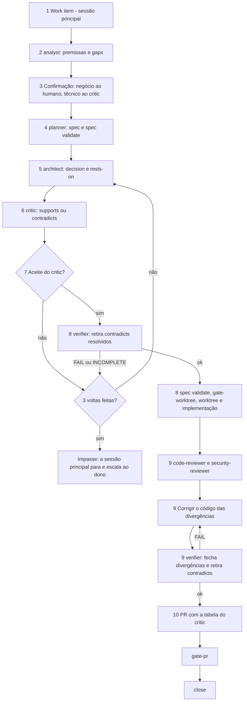

# Fluxo por diretivas e premissas

Vocabulário em [GLOSSARY.md](../GLOSSARY.md). Visão geral e primeiros passos no [README](../README.md). A branch, a marca da `develop` e os checks mecânicos estão em [mechanical-gates.md](mechanical-gates.md).

O humano define diretivas e premissas. O agente escolhe os comportamentos e escreve a spec a partir delas. Este fluxo roda no binário `omhl`, sem o hexlog em TypeScript. O núcleo `crates/hexlog` não muda: tipos, relações, gates, hooks e comandos deste fluxo são do `omhl`.

**Estado de ativação.** O gate de criação da worktree (`.config/wt.toml`) e os dois hooks `PreToolUse` do plugin (`plugin/hooks/hooks.json`) estão ativos: o `wt` chama o `omhl gate-worktree` antes de criar uma worktree, o Claude Code chama o `omhl hook spec-lock` antes de cada `Edit`, `Write` e `MultiEdit`, e chama o `omhl hook agent-role` antes de cada `Bash` (seção 12). A ordem da ativação e o que o dono faz a cada mudança estão na seção 10.

Os exemplos de saída vêm de uma execução real do `omhl` num repositório descartável. Onde um caminho absoluto aparece, ele foi encurtado para `<repo>`.

## 1. O ciclo

| # | Etapa | Quem | O que acontece |
|---|---|---|---|
| 1 | Premissa | Agente | Grava o work item e sugere premissas (`append`). Premissa de negócio sugerida fica pendente e não vincula |
| 2 | Confirmação humana | Humano | Confirma dentro da sessão. O agente grava a premissa com `confirmed_by`, copiando a pergunta e a resposta literais |
| 3 | Gate de criação | `omhl gate-worktree` | Confere, pelo prefixo da branch, o que a matriz pede. Sem isso, a worktree não nasce |
| 4 | Spec | Agente | `omhl spec init` cria a pasta, o agente escreve as partes e `omhl spec validate` as aprova |
| 5 | Congelamento | `omhl hook spec-lock` | Com a branch do work item criada, nenhuma parte da spec se edita mais |
| 6 | Gap e divergência | Agente | Dúvida técnica vira `gap`, respondido por uma premissa. Desvio da spec vira `divergence` com `resolution` `open` |
| 7 | Emenda | Agente e humano | Se a spec estava errada, o agente cria `emenda-NN.md` e o humano a aprova. A parte original não muda |
| 8 | Retro | `omhl close` | Ao fechar o work item, o `omhl` imprime um relatório somente leitura. O agente propõe melhorias, cada uma só vale com a confirmação do humano |
| 9 | Promoção | Agente e humano | Premissa repetida em 3 work items distintos vira sugestão de diretiva. O humano confirma |

Ordem do protocolo, antes do código: escolher prefixo, id e slug; gravar o work item (`work-items.<id>`); sugerir as premissas; confirmar com o humano; criar e validar a spec; só então `wt switch -c`.

A tabela descreve o protocolo sem dizer quem o cumpre. Com os agentes do plugin, cada etapa tem um papel `oh-my-hexflow:<papel>` e há uma volta de consenso entre o architect e o critic antes da spec valer: o ciclo de dez passos está na seção 12.

O work item nasce pelo `append` que já existia, sem comando novo. A guarda recusa premissa, gap e divergência novos cujo `work_item` não aponta para um work item aberto.

### A matriz de prefixos

O prefixo é o `tipo` de `tipo/wi-<id>__<slug>`. Qualquer prefixo fora da tabela é recusado com `prefix-not-allowed`.

| Prefixo | Exige para criar a worktree (`require`) |
|---|---|
| `feat/`, `fix/` | `business-premise` e `spec` |
| `refactor/`, `tests/` | `technical-premise-confirmed` |
| `bugfix/` | `agent-premise` |
| `chore/`, `docs/` | nada |

Os átomos de `require`:

| Átomo | Satisfeito quando |
|---|---|
| `business-premise` | O work item tem 1+ premissa `kind` `business` confirmada (`status` `confirmed` com `confirmed_by`) |
| `technical-premise-confirmed` | O mesmo, com `kind` `technical` |
| `agent-premise` | O work item tem 1+ premissa `kind` `technical`, confirmada ou não. Uma premissa que o humano confirmou depois também serve |
| `spec` | `omhl spec validate` passa para o work item |

Edição direta na `develop` nunca passa pelo gate. A `develop` e a `main` saem do gate com `allowed` (`exempt-branch`).

## 2. Comandos

Um erro sai no stderr com código de saída 1, e uma saída de sucesso no stdout. Os 21 comandos ativos imprimem texto `agent` por padrão, com `--format human` (os mesmos fatos em blocos) e `--format json` (uma linha de JSON, a forma de ler por código); um erro sai em texto (`✘ código · mensagem`). Os cinco comandos lidos por máquina (`hook session-start`, `hook spec-lock`, `hook agent-role`, `hooks post-commit` e `gate-worktree`) seguem em JSON e recusam `--format agent|human` com erro de uso (saída 2). A decisão está no [ADR 0009](adr/0009-formato-de-saida-agent-human-json-e-registro-de-renderizadores.md).

| Comando | O que faz |
|---|---|
| `omhl spec init <work-item> <slug>` | Cria a pasta da spec do work item, com a primeira parte, no diretório principal |
| `omhl spec validate <work-item>` | Valida a estrutura e o grafo da pasta de spec do work item |
| `omhl gate-worktree --branch <nome>` | Decide se a worktree da branch pode ser criada |
| `omhl hook spec-lock` | Hook `PreToolUse` do Claude Code: lê o evento no stdin e nega a edição de spec congelada |
| `omhl hook agent-role` | Hook `PreToolUse` do Claude Code para o `Bash` e o `Monitor`: lê o evento no stdin e aplica a matriz do papel ao agente portado (seção 12) |
| `omhl report answers [--work-item <id>]` | Estado de cada gap, quem o respondeu e se uma diretiva sustenta a resposta. Recusa um work item que não existe |
| `omhl report recurrences [--min <n>]` | Premissas repetidas em work items suficientes para sugerir a promoção |
| `omhl report retro <work-item>` | A retro de um work item, aberto ou fechado |
| `omhl list --where <campo>=<valor>` | Filtra os nodes por igualdade de campo de texto; as regras de recusa estão no [ADR 0007](adr/0007-opcoes-da-cli-sao-respeitadas-ou-recusadas.md) |
| `omhl close <work-item>` | Passa a devolver o campo `retro` (seção 8) |

A interface do agente é a CLI.

**`list`: opção respeitada ou recusada.** O `list` não devolve `{"items":[]}` para um filtro que nunca casaria nada: ele recusa com `invalid-arguments` e uma mensagem que diz a regra, sem repetir o valor ([ADR 0007](adr/0007-opcoes-da-cli-sao-respeitadas-ou-recusadas.md)). As regras:

- **`--limit`** de 1 a 200 (o teto da página); `0` e acima de 200 recusam em `/limit`.
- **`--id-prefix`** é uma sequência de nomes separados por `.`: cada segmento tem de 1 a 63 caracteres, feitos de letras minúsculas, dígitos e hífens, e não começa por hífen, com até 200 caracteres no total (recusa em `/id_prefix`). O prefixo casa por **segmento inteiro**: `premises.cli1` não casa `premises.cli1-b1`. O primeiro segmento precisa ser o namespace de um tipo (`premises`, `work-items`, `checks`; `premise` no singular recusa), e, com `--type`, o namespace daquele tipo.
- **`--type`** precisa existir no catálogo (`premises` no plural recusa, em `/type`).
- **`--where campo=valor`** repete: todos os pares precisam bater. O valor é texto, e o `omhl` divide no primeiro `=`, então o valor pode conter `=`. Um par sem `=` ou com o campo vazio responde `invalid-arguments` em `/where/<índice>` ("where must be FIELD=VALUE with a non-empty FIELD"). O campo precisa ser de **texto**: o schema tem `type: "string"`, ou não tem `type` e todo valor do `enum` é string (é o caso de `status`, `kind`, `resolution`, `concern` e `outcome`); `boolean`, `integer`, `array` e `object` não são, então `--where blocking=true` recusa. Um campo repetido com valores diferentes recusa, e essa checagem vem antes da do valor no `enum`: `--where status=open --where status=closed` responde campo repetido, não valor fora do `enum`; o mesmo par repetido segue aceito. Um valor fora do `enum` do campo recusa (`status=confimed`).
- **Tipos candidatos.** Com `--type`, o único candidato é ele. Sem `--type`, são os tipos que o namespace do `--id-prefix` admite, ou todos os do catálogo. O filtro vale se algum candidato declara **todos** os campos do `--where` como texto e aceita os valores; senão o `omhl` recusa em `/where/<índice>`. Por isso `--where status=open` e `--where kind=missing` funcionam sem `--type`, e `--where title=x --where kind=missing` recusa (nenhum tipo declara os dois).
- Os tetos de pares (8) e de tamanho do valor (`where-eq-value-too-long`, para um valor acima de 256 caracteres) vêm do núcleo e são conferidos depois das regras acima.
- **Ordem de conferência.** O primeiro erro vence: sintaxe de cada `--where` (no adapter); `--limit`; sintaxe do `--id-prefix`; sintaxe do `--type`; `--type` no catálogo; namespace do `--id-prefix`; campo repetido com valor diferente; cada `--where` em ordem de índice (campo, texto, valor aceito); por último os tetos do núcleo (8 pares, 256 caracteres).

Um filtro válido pode devolver `[]` de verdade (um `work_item` sem nodes, um `--after-seq` além da cabeça). O `--project-dir`, em qualquer comando, precisa existir: um diretório inexistente recusa com `invalid-project-dir` (saída 1) em vez de subir até o projeto de um ancestral. Para consultar divergências de um work item:

```bash
omhl list --type divergence --where work_item=work-items.w1 --where resolution=open
```

**Autoria.** Grave tudo pela CLI: `omhl append` (JSON no stdin) e `omhl attest`. A CLI grava `agent: "user"`, com uma exceção: sob o Claude Code (variável `CLAUDECODE=1`, que ele e as extensões de IDE definem em subprocessos e terminais integrados: Bash, hooks, tmux e o terminal integrado da IDE), a CLI grava `agent: "claude"` com `client: "cli"`. O erro seguro é o falso positivo: um humano que roda o `omhl` dentro de uma sessão do Claude Code, ou no terminal integrado de uma IDE, sai registrado como agente. O inverso, `env -u CLAUDECODE`, grava `agent: "user"` (Follow-up da trava técnica, seção 3). Com `OMHL_ROLE=omhl:<papel>` sob o Claude Code, a CLI grava `agent: "omhl:<papel>"` no lugar de `"claude"` (seção 8, "A matriz por papel"). Quem define a variável para o agente portado é o hook `agent-role`, que a escreve no comando a partir do `agent_type` do evento (seção 12).

**Skills do plugin.** A skill [`directives-flow`](../plugin/skills/directives-flow/SKILL.md) leva este fluxo ao agente. Para cada um dos comandos acima, que ela cobre (`append`, `gate-worktree`, `guideline retire`, `spec init`, `spec validate`), há uma página em [`plugin/skills/directives-flow/references/`](../plugin/skills/directives-flow/references/) com entradas, saída, erros e exemplos que um teste executa contra o `omhl` real (ver [architecture.md](architecture.md), seção 4). A mesma pasta traz as páginas de apoio ao ciclo com os agentes: `cycle.md` (os dez passos), `roles.md` (quem faz cada papel e o que a sessão principal lhe passa) e `tracking-table.md` (o template da tabela do PR). Essas páginas não têm os cinco títulos das páginas de comando nem exemplos executáveis. O `omhl attest` é coberto pela skill [`mechanical-checks`](../plugin/skills/mechanical-checks/SKILL.md). As skills [`plan-consensus`](../plugin/skills/plan-consensus/SKILL.md) e [`review`](../plugin/skills/review/SKILL.md) conduzem a sessão principal pelos agentes (seção 12) e exigem a `directives-flow`.

## 3. Confirmação humana (`confirmed_by`)

Diretiva (`guideline`) e premissa de negócio só vinculam o agente depois de confirmadas. A premissa técnica pode ser autônoma (`status` `assumed`): o agente a registra sozinho e o humano confirma depois, se quiser.

Premissa confirmada tem uma regra só, em todos os pontos que a leem (render, gate, `spec validate` e relatório de gaps): `status` `confirmed` **e** `confirmed_by` presente. Uma premissa antiga `confirmed` sem `confirmed_by` vale como não confirmada em todos eles, e um `assumed` com `confirmed_by` também não é confirmado.

A confirmação é a aprovação do humano dentro da sessão. O registro leva o campo `confirmed_by`, com a pergunta e a resposta literais como evidência:

```json
"confirmed_by": {
  "by": "person:alice",
  "question": "<pergunta literal feita ao humano>",
  "answer": "<resposta literal do humano>"
}
```

- `by` tem de 1 a 100 caracteres e começa com `person:`, seguido de ao menos um caractere.
- Exceção: o `omhl:critic` confirma premissa técnica com `"by": "critic"`. Vale só quando o autor é `omhl:critic`, o tipo é `premise`, o `kind` é `technical` e `question` e `answer` literais estão presentes e não vazios. Outro autor com `by: "critic"`, ou o critic numa premissa de negócio que ele cria, é `confirmation-invalid`. O critic gravando diretiva ou divergência responde antes `role-record-forbidden`, e revisando premissa de negócio alheia, `role-revision-forbidden`.
- `question` e `answer` têm de 1 a 2000 caracteres. Um texto maior é recusado, nunca truncado: o literal não pode mudar.
- O campo é opcional em `premise`, `guideline` e `divergence`. Um record antigo, sem ele, continua válido.
- `premise` ganha também o `kind` (`technical` ou `business`).

A guarda do `append` impõe estas regras. A mensagem de erro traz o código e o ponteiro do campo, nunca o conteúdo da pergunta, da resposta ou da spec.

| Código | Quando |
|---|---|
| `confirmation-required` | Uma premissa `confirmed`, uma diretiva ou uma divergência `spec-stale` chegou sem `confirmed_by`, ou a divergência `spec-stale` chegou sem `amendment` |
| `confirmation-invalid` | O `by` não começa com `person:` ou não tem nome depois dele (salvo a confirmação do critic, acima); uma premissa que não é `confirmed` traz `confirmed_by`; uma divergência que não é `spec-stale` traz `confirmed_by` ou `amendment`; o `amendment` não tem a forma `emenda-NN` |

Uma premissa com `kind` e sem `work_item` responde `work-item-not-found` em `/items/0/body/data/work_item`. Uma premissa sem `kind` e sem `work_item` é permitida: ela não pertence a nenhum work item e não expira.

Os records que o `omhl load` grava (cliente `loader`) estão isentos. Uma diretiva vinda de um arquivo de `.omhl/guidelines/` e uma diretiva nativa valem como confirmadas, sem `confirmed_by`.

A confirmação é autodeclarada: o `Author` do record continua sendo quem o digitou, não quem confirmou. É um rastro, não uma prova. A trava técnica contra forja de `confirmed_by` não existe nesta entrega.

## 4. O arquivo `.omhl/workflow.toml`

Um arquivo opcional e versionado configura o fluxo. Sem ele valem os padrões abaixo. O `omhl load` ignora o arquivo e a pasta de specs; eles não geram `unknown-entry`.

A política vale sempre da cópia do diretório principal: o gate, o hook de congelamento, o `spec init`, o `spec validate`, o `report` e o scan leem o mesmo arquivo, qualquer que seja a worktree da sessão. Só quando o git não responde (sem repositório) vale a cópia da raiz do projeto. Mudar o `workflow.toml` numa branch ou worktree ligada só vale depois do merge no diretório principal; a cópia da branch não muda a validação dela.

```toml
version = 1

[specs]
dir = ".omhl/specs"
max_lines = 300
placeholders = ["TODO", "TBD", "FIXME", "???"]
cite_business_premise = true

[promotion]
min_work_items = 3

[prefix.feat]
require = ["business-premise", "spec"]
[prefix.fix]
require = ["business-premise", "spec"]
[prefix.refactor]
require = ["technical-premise-confirmed"]
[prefix.tests]
require = ["technical-premise-confirmed"]
[prefix.bugfix]
require = ["agent-premise"]
[prefix.chore]
require = []
[prefix.docs]
require = []
```

| Chave | Efeito |
|---|---|
| `version` | Obrigatória quando o arquivo existe. O único valor aceito é `1` |
| `specs.dir` | Pasta das specs, relativa ao diretório principal (e lida do `workflow.toml` dele). É recusado: caminho absoluto, com `..`, sem pasta própria (`""`, `.`, `./`), o `.git` e o `.omhl` sozinhos, e qualquer coisa dentro de `.git`, `.omhl/checks`, `.omhl/guidelines`, `.omhl/projection` e `.omhl/workflow.toml`. O padrão `.omhl/specs` e pastas como `docs/specs` valem |
| `specs.max_lines` | Máximo de linhas de cada parte e de cada emenda. Mínimo `1`. Cada arquivo também tem um teto fixo de 65 536 bytes (64 KiB), que não é configurável |
| `specs.placeholders` | Textos que reprovam a spec (`placeholder-found`). A lista substitui a padrão |
| `specs.cite_business_premise` | Quando `true`, a spec de um work item precisa citar uma premissa de negócio confirmada dele |
| `promotion.min_work_items` | Número de work items distintos que dispara a sugestão de promoção |
| `prefix.<nome>.require` | Átomos exigidos pelo prefixo. `[prefix.<novo>]` acrescenta um prefixo à tabela; um prefixo existente é sobrescrito |

O arquivo é estrito: uma chave desconhecida é erro. O erro é `invalid-workflow-config`. A mensagem traz o caminho e a posição (linha e coluna), nunca o conteúdo do arquivo:

```json
{"error":{"code":"invalid-workflow-config","details":[],"message":"<repo>/.omhl/workflow.toml: not a valid workflow file at line 3, column 1"}}
```

O `specs.dir` é lido pelo scanner de extensions, pelo `spec init`, pelo `spec validate` e pelo hook de congelamento. Trocá-lo numa branch não desliga o congelamento, porque só a cópia do diretório principal vale. Um `workflow.toml` inválido não é lido: o scan cai nos padrões e avisa (`invalid-workflow-config`, também no `omhl load` e no `session-start`), e o hook segue a decisão com os padrões.

## 5. O gate de criação da worktree

O `omhl gate-worktree --branch <nome>` decide se a worktree de uma branch pode nascer. O `--branch` aceita valor com hífen inicial e a forma `--branch=<valor>`. O agente roda o mesmo comando para conferir antes de chamar o `wt`.

O comando decide nesta ordem, antes de abrir o banco:

1. Sem `.omhl.toml` acima do diretório, a CLI sai com `0` e sem nenhuma saída (o hook roda em qualquer repositório).
2. `develop` e `main`: `allowed` com `reason` `exempt-branch`.
3. Branch local que já tem worktree (`git worktree list --porcelain`): `allowed` com `reason` `worktree-exists`.
4. O resto é criação. O nome precisa seguir `tipo/wi-<id>__<slug>` e o `tipo` precisa estar na tabela de prefixos. O `omhl` confere que o work item existe e está aberto, lê as premissas dele no banco, valida a spec quando o `require` pede `spec` e aplica a matriz. O banco só é aberto quando o `require` tem algum átomo de premissa ou `spec`.

Quando a matriz é satisfeita, a saída é `{"allowed":true,"branch":"feat/wi-w1__export-reports","reason":"matrix-satisfied"}`. Um prefixo com `require = []` (`chore/`, `docs/`) sai com `matrix-satisfied` sem abrir o banco, então o gate não confere se o work item existe.

| Código | Quando | O que tentar |
|---|---|---|
| `worktree-gate-refused` | A matriz do prefixo não foi satisfeita. O `context` do detalhe traz `branch`, `prefix`, `work_item`, `missing` (os átomos que faltam) e `main_dir` | Registre e confirme o que `missing` lista, ou escreva e valide a spec. Repita o gate |
| `work-item-not-found`, `work-item-closed` | O `require` do prefixo abre o banco e o work item da branch não existe ou já foi fechado. O ponteiro é `/branch`. Prefixo com `require = []` não chega aqui | Grave o work item ou use outra branch. Para reabrir uma fatia antiga, veja os bypasses na seção 10 |
| `prefix-not-allowed` | O nome não segue `tipo/wi-<id>__<slug>`, ou o `tipo` não está na tabela. `pr:N` e `dependabot/...` caem aqui | Corrija o nome. Para uma branch de terceiros, veja os bypasses na seção 10 |
| `main-dir-unknown` | O `git` não resolveu o diretório principal do repositório (por exemplo, repositório bare) | Rode num checkout comum |
| `spec-store-unusable` | O `require` pede `spec` e a pasta de spec do work item não pode ser lida (arquivo que não é regular, pasta ilegível, mais de uma pasta `wi-<id>__*`). O ponteiro é `/work_item` | Corrija a pasta de spec no diretório principal |
| `invalid-workflow-config` | O `.omhl/workflow.toml` é inválido (seção 4) | Corrija o arquivo |

Exemplo de recusa (campos de `context` abreviados):

```json
{"error":{"code":"worktree-gate-refused","details":[{"code":"worktree-gate-refused","context":{"branch":"feat/wi-w1__x","kind":"worktree-gate-refused","main_dir":"<repo>","missing":["business-premise","spec"],"prefix":"feat","work_item":"work-items.w1"},"message":"the premises the branch prefix requires are missing","path":"/branch"}],"message":"the premises the branch prefix requires are missing"}}
```

Quando a spec não existe ou não valida, o gate trata `spec` como não satisfeito. A violação da spec nunca sai na recusa do gate: rode `omhl spec validate` para vê-la.

### O hook `pre-switch` do `wt`

O gate roda pelo `wt`, pelo hook de projeto versionado em `.config/wt.toml`:

```toml
[pre-switch]
omhl-gate = "case {{ branch }} in develop|main) exit 0;; esac; omhl gate-worktree --branch {{ branch }}"
```

- O template é POSIX: no `wt` 0.70.0 o hook rodou sob `sh` (observado no spike; a doc do `wt` diz só que ele roda comandos de shell). O `{{ branch }}` vai **sem aspas**: o `wt` já escapa a variável, e as aspas anulam o escape. Com aspas simples, o nome `a$(id)` executa `id`. Sem aspas, nenhum dos 12 nomes perigosos do spike executou nada.
- O `pre-switch` roda antes de a branch e a worktree existirem num `wt switch -c`. Uma saída não zero aborta, e não sobra branch nem diretório.
- Num `wt switch -c`, o `{{ branch }}` é o destino. `^`, `-` e `@` chegam resolvidos. `pr:N` chega literal (observado no `wt` 0.70.0, sem apoio na doc), porque o hook roda antes de o `wt` buscar o PR, e o gate o recusa com `prefix-not-allowed`.
- O `case` garante `wt switch develop` e `wt switch main` mesmo sem o `omhl` no `PATH`. Para qualquer outro nome, sem o `omhl` o `sh` sai com `127` e o `wt` aborta.
- O hook não passa `--project-dir`, então a recusa de um `--project-dir` inexistente (`invalid-project-dir`, saída 1) não o afeta. Quem chama `omhl gate-worktree --project-dir <caminho>` à mão com um caminho que não existe passa a receber essa recusa, em vez de saída 0 muda.
- O `omhl` do hook é o do `PATH`. Instale-o fora de qualquer worktree (veja `binary-in-worktree` na seção 5 de [mechanical-gates.md](mechanical-gates.md)), senão um `wt remove` o apaga.
- O gate só funciona com o `omhl` no `PATH` do `wt`. Sem ele, todo `wt switch` para uma branch que não seja `develop` nem `main` sai com `127` e o `wt` aborta, inclusive `wt switch -c`. Confira com `command -v omhl` antes de rodar `wt config approvals add`.
- **`wt switch -c` parte da `main`**, a branch padrão, não da `develop`. Para partir da `develop`, passe `--base develop`.

**A aprovação do hook.** O `wt` guarda a aprovação de um comando de projeto pelo projeto e pelo **texto do comando**. Qualquer mudança no texto do comando em `.config/wt.toml` pede uma aprovação nova. Sem aprovação salva e sem terminal interativo, o `wt` aborta todo `wt switch`, inclusive para a `develop`, com `Cannot prompt for approval in non-interactive environment` (saída 1). O `case` do hook não ajuda, porque o `wt` pede a aprovação antes de rodar o hook.

- O dono aprova uma vez, ao ativar, e de novo a cada mudança do texto do comando: `wt config approvals add`.
- `wt config approvals list` confere. O comando sem aprovação aparece como `UNAPPROVED`.
- Se um `wt switch` falhar com `Cannot prompt for approval`, o agente para e pede ao dono o `wt config approvals add`. Ele nunca tenta `--no-hooks`.

## 6. A spec

As specs ficam em `<specs.dir>/wi-<id>__<slug>/`, por padrão `.omhl/specs/wi-<id>__<slug>/`. A pasta tem as partes `parte-NN.md` (`NN` com dois dígitos) e, depois, as emendas `emenda-NN.md`. Elas ficam fora do git: a worktree não as recebe, e o `spec validate` acha o diretório principal sozinho, de qualquer worktree.

### `omhl spec init`

```bash
omhl spec init work-items.w1 export-reports
```

```json
{"dir":"<repo>/.omhl/specs/wi-w1__export-reports","path":"<repo>/.omhl/specs/wi-w1__export-reports/parte-01.md","slug":"export-reports","work_item":"work-items.w1"}
```

O comando cria a pasta no diretório principal, com o `parte-01.md` já com as cinco seções vazias, e escreve `<specs.dir>/.gitignore` com `*`. Nenhum projeto precisa editar o `.gitignore` da raiz.

| Código | Quando |
|---|---|
| `spec-slug-invalid` | O slug não tem 1 a 64 caracteres de `a-z`, `0-9` e `-`, ou começa com `-`. O slug vira nome de pasta |
| `spec-exists` | O work item já tem uma pasta de spec, de qualquer slug |
| `spec-store-unusable` | A pasta de specs não pode ser lida nem escrita, passa de 10 000 entradas, ou o work item tem mais de uma pasta `wi-<id>__*`. O ponteiro é `/work_item` |
| `work-item-not-found`, `work-item-closed` | O work item não existe ou já foi fechado |

### O formato

Cada parte tem estas cinco seções `##`, nesta ordem:

1. `Objetivo`
2. `Diretivas e premissas aplicáveis`: os ids citados (`premises.<nome>` e `guidelines.<nome>`). O `<nome>` pode ter vários segmentos separados por `.`, como `premises.row-limit.fallback`; vale também para `gaps.<nome>` e `divergences.<nome>`
3. `Comportamentos`: itens `- CMP-###: ...`, um comportamento por item; ao menos um item
4. `Critérios de aceitação`: itens `- CA-###: ...`, mensuráveis; ao menos um item
5. `Fora de escopo`

Cada parte tem no máximo `specs.max_lines` linhas (300 por padrão) e no máximo 64 KiB. Passou disso, divida o trabalho em mais partes completas, todas no mesmo work item. Uma dúvida aberta entra no texto como `[PENDENTE: gaps.<nome>]`.

Exemplo de parte válida:

```markdown
## Objetivo

Permitir que o usuário exporte relatórios em CSV.

## Diretivas e premissas aplicáveis

- premises.p1

## Comportamentos

- CMP-001: o botão de exportar gera um CSV com todas as linhas do relatório.
- CMP-002: o limite de linhas por arquivo é [PENDENTE: gaps.row-limit].

## Critérios de aceitação

- CA-001: um relatório de 10 linhas gera um CSV com 11 linhas, contando o cabeçalho.

## Fora de escopo

- Exportar em PDF.
```

### `omhl spec validate`

```bash
omhl spec validate work-items.w1
```

Com sucesso, a saída lista as partes e o estado de cada emenda:

```json
{"amendments":[{"name":"emenda-01.md","state":"approved","violations":[]}],"ok":true,"parts":["parte-01.md"]}
```

Com violação, o erro é `spec-invalid`. Cada detalhe traz o `path` (`<arquivo>:<linha>`, linha a partir de 1) e o `code` da regra. O erro lista até 20 detalhes e conta os omitidos na mensagem. O conteúdo da spec nunca entra no erro. Sem pasta ou sem nenhuma parte, o erro é `spec-not-found`. Pasta ilegível, arquivo de spec que não é regular ou não é UTF-8, mais de uma pasta `wi-<id>__*` do work item e mais de 10 000 entradas em `specs.dir` dão `spec-store-unusable` (ponteiro `/work_item`), não `spec-invalid`.

As violações de uma parte reprovam sempre. As de uma emenda reprovam só quando a emenda está aprovada (seção 9). Uma emenda `pending` com violação aparece em `amendments[].violations` e não derruba o `ok`.

**Regras de estrutura** (parte e emenda):

| Código | Quando |
|---|---|
| `sections-invalid` | As seções não são exatamente as esperadas, na ordem: faltam, sobram ou estão trocadas. Parte: as cinco acima. Emenda: `Divergência`, `Correções` e `Motivo` |
| `section-empty` | O corpo da seção só tem linhas em branco |
| `section-without-items` | A seção `Comportamentos` ou `Critérios de aceitação` de uma parte tem texto, mas nenhum item `- `. A regra vale para cada parte, sem somar as outras. A seção em branco é `section-empty`, não esta |
| `item-id-invalid` | Um item de `Comportamentos` não começa com `CMP-###`, um de `Critérios de aceitação` não começa com `CA-###`, ou um de `Correções` não começa com `EMD-###`. O número tem 3 dígitos |
| `item-id-duplicate` | O mesmo `CMP-###` ou `CA-###` aparece em mais de um lugar das partes, ou o mesmo `EMD-###` em mais de um lugar das emendas, inclusive numa emenda abandonada |
| `file-too-long` | O arquivo passa de `specs.max_lines` linhas. A linha reportada é a primeira acima do teto |
| `file-too-large` | O arquivo passa de 65 536 bytes (64 KiB), mesmo com poucas linhas. O arquivo não é lido e a linha reportada é sempre `1` |
| `placeholder-found` | Uma linha contém algum texto de `specs.placeholders` |
| `pending-marker-invalid` | Existe um `[PENDENTE` que não tem a forma `[PENDENTE: gaps.<nome>]` |

**Regras da emenda** (estrutura):

| Código | Quando |
|---|---|
| `divergence-ref-invalid` | A seção `Divergência` não cita exatamente um `divergences.<nome>` |
| `correction-invalid` | Um item de `Correções` não tem a forma `- EMD-### <alvo>: <novo valor>`, com alvo `CMP-###`, `CA-###` ou `EMD-###` e valor não vazio |
| `correction-target-unknown` | O alvo não existe: um `CMP` ou `CA` que nenhuma parte define, ou um `EMD` que não foi definido numa emenda anterior |
| `amendment-defines-item` | A emenda define um item `CMP-###` ou `CA-###`. Esses ids só se definem nas partes |
| `amendment-name-invalid` | O arquivo de emenda não se chama `emenda-NN.md` com dois dígitos |
| `amendment-number-duplicate` | Duas emendas têm o mesmo número |

**Regras do grafo** (consultam o banco):

| Código | Quando |
|---|---|
| `cited-id-unknown` | Um `premises.<nome>` ou `guidelines.<nome>` citado em `Diretivas e premissas aplicáveis` não existe |
| `cited-id-unconfirmed` | O id existe e não está confirmado. Premissa: `confirmed` com `confirmed_by`. Diretiva: `confirmed_by`, ou vinda de extension ou nativa |
| `business-premise-missing` | Com `specs.cite_business_premise` ligado, nenhuma parte cita uma premissa de negócio confirmada do próprio work item. A linha reportada é a da seção de diretivas da primeira parte |
| `pending-gap-unresolved` | Um `[PENDENTE: gaps.<nome>]` aponta para um gap `open` ou `needs-human`. Um gap que não existe vale como `open` |

As regras da emenda que dependem da divergência citada (`amendment-divergence-unknown`, `amendment-divergence-foreign`, `amendment-divergence-closed` e `amendment-correction-missing`) estão na seção 9.

## 7. O congelamento

O hook `omhl hook spec-lock` é um `PreToolUse` do Claude Code para `Edit`, `Write` e `MultiEdit`. Depois que a branch do work item existe, ele barra a edição da spec. **Não existe marca nem comando para descongelar**: uma spec aprovada nunca é editada. A correção entra como emenda (seção 9).

O hook lê o evento no stdin e decide por regras fechadas:

1. O caminho precisa estar sob `<specs.dir>/wi-<id>__<slug>/`. Senão ele sai com `0` sem abrir banco nem git. O caminho é normalizado no texto (`.` e `..`) antes do filtro.
2. Está congelada a spec cujo work item tem uma branch local (`tipo/wi-<id>__<slug>`). O hook só olha o disco e o git, nunca o banco.
3. Numa spec congelada, o hook nega `Edit` e `MultiEdit` em qualquer arquivo da pasta, `Write` sobre um arquivo que já existe e `Write` de uma `parte-NN.md` nova.
4. Numa spec congelada, nenhum arquivo se escreve numa pasta que não existe. Pasta nova do work item (por exemplo, um slug digitado errado) é negada com `spec-folder-unknown`.
5. A única exceção é a criação de emenda: `Write` de um arquivo que ainda não existe, chamado `emenda-NN.md`, em que `NN` é o próximo número da pasta (o maior existente mais um, ou `01`). Um arquivo novo que não é `parte-*` nem `emenda-*` (por exemplo `notas.md`) também passa.
6. Escrever uma spec dentro de uma worktree ligada é barrado, com ou sem branch do work item.

A negação sai no stdout, com código de saída `0`:

```json
{"hookSpecificOutput":{"hookEventName":"PreToolUse","permissionDecision":"deny","permissionDecisionReason":"spec-frozen: the spec in <repo>/.omhl/specs/wi-w1__export-reports is frozen because the work item has a branch; to correct it, record a divergence and create the amendment <repo>/.omhl/specs/wi-w1__export-reports/emenda-01.md (Write of a new file)"}}
```

| Código | Quando | O que fazer |
|---|---|---|
| `spec-frozen` | A edição é de uma spec congelada. A mensagem diz o caminho da emenda que se pode criar | Registre uma `divergence` e crie a emenda (seção 9) |
| `spec-in-linked-worktree` | O caminho está numa worktree ligada. As specs vivem só no diretório principal | Escreva no caminho do diretório principal que a mensagem informa |
| `spec-folder-unknown` | O work item tem branch e a pasta do caminho não existe. Vale para qualquer arquivo | Escreva a emenda na pasta de spec que o work item já tem |

O subcomando `hook spec-lock` nunca sai com `2`. Qualquer erro interno (git, leitura, JSON) libera a escrita, sai com `0` e deixa uma linha de erro no stderr. O hook acha o projeto pelo caminho do arquivo e, se ele estiver fora de qualquer projeto, pelo `cwd` da sessão. Um `omhl` velho, sem o subcomando, é outro caso: o clap sai com `2`, e o envoltório `|| exit 1` do `hooks.json` o converte em `1` (seção 10). Um `.omhl/workflow.toml` inválido não libera: o hook decide com os padrões (com um `specs.dir` customizado e o arquivo inválido, a pasta customizada fica sem trava, pois o `specs.dir` não é legível).

## 8. Gap, divergência e retro

### Gap e a cadeira do dono

Uma dúvida aberta é um `gap` (`question` e `context`, mais o `work_item` e o `kind` opcionais; o `kind` é `technical` ou `business`, e um gap sem `kind` vai para o humano). Um gap fecha quando uma premissa o responde, pela relation `answers` de premissa para gap. Uma diretiva que serve de critério da resposta é uma relation `supports` de diretiva para premissa. Uma resposta que contraria uma diretiva confirmada é uma `contradicts` de premissa para diretiva.

```json
{"items":[{"body":{"kind":"relation","relation_type":"answers","from":"premises.row-limit","to":"gaps.row-limit"}}]}
```

O `omhl report answers` mostra o estado de cada gap:

```bash
omhl report answers --work-item work-items.w1
```

```json
{"gaps":[{"answered_by":"premises.row-limit","answerer":"autonomous","author":{"agent":"claude","client":"cli"},"id":"gaps.row-limit","no_criterion":true,"state":"answered","work_item":"work-items.w1"}]}
```

| Campo | Valores |
|---|---|
| `state` | `open`: nenhuma resposta. `answered`: há resposta. `needs-human`: a resposta não é de pessoa (`autonomous` ou `critic`) e contraria uma diretiva confirmada; o gap segue contando como aberto no validador e na retro |
| `answerer` | `human` quando a premissa que responde está confirmada (`confirmed` com `confirmed_by`) e o `by` começa com `person:`; `critic` quando o `by` é `critic`; `autonomous` em qualquer outro caso, inclusive a premissa antiga `confirmed` sem `confirmed_by` e a `assumed` com `confirmed_by` |
| `no_criterion` | `true` quando nenhuma diretiva confirmada sustenta a resposta |

Com mais de uma resposta, vale a premissa confirmada por pessoa. Sem ela, vale a confirmada pelo critic. Sem nenhuma das duas, vale a primeira em ordem de gravação; um empate entre respostas do mesmo respondente também cai na primeira gravada. A cadeira aceita o papel `omhl:critic`, que responde só gap técnico (subseção abaixo). O agente `oh-my-hexflow:critic` cumpre esse papel (seção 12).

### A matriz por papel

Sete papéis portados gravam com `agent: "omhl:<papel>"`. Cada um grava só os tipos da sua linha:

| Papel | `commands` | `append.nodes` | `append.relations` | `append.retire` |
|---|---|---|---|---|
| `omhl:analyst` | `append`, `list`, `get`, `render`, `verify`, `byproduct`, `report answers`, `report recurrences`, `report retro`, `help` | `premise`, `gap` | | |
| `omhl:planner` | `spec init`, `spec validate`, `list`, `get`, `render`, `verify`, `byproduct`, `report answers`, `report recurrences`, `report retro`, `help` | | | |
| `omhl:architect` | `append`, `list`, `get`, `render`, `verify`, `byproduct`, `report answers`, `report recurrences`, `report retro`, `help` | `decision` | `rests-on` | |
| `omhl:critic` | `append`, `spec validate`, `list`, `get`, `render`, `verify`, `byproduct`, `report answers`, `report recurrences`, `report retro`, `help` | `decision`, `premise` | `supports`, `contradicts`, `answers`, `rests-on` | |
| `omhl:code-reviewer` | `append`, `list`, `get`, `render`, `verify`, `byproduct`, `report answers`, `report recurrences`, `report retro`, `help` | `divergence`, `decision` | `contradicts`, `rests-on` | |
| `omhl:security-reviewer` | `append`, `list`, `get`, `render`, `verify`, `byproduct`, `report answers`, `report recurrences`, `report retro`, `help` | `divergence`, `decision` | `contradicts`, `rests-on` | |
| `omhl:verifier` | `append`, `spec validate`, `list`, `get`, `render`, `verify`, `byproduct`, `report answers`, `report recurrences`, `report retro`, `help` | `divergence` | | `contradicts` |

`commands` é a referência dos comandos de cada papel, com a leitura que vale para os sete. A CLI só confere as três colunas de `append`. Um teste mantém esta tabela igual à matriz compilada no `omhl`.

**Como o papel chega.** A variável `OMHL_ROLE=omhl:<papel>` troca o `agent` do record e vale só sob o Claude Code. Valor vazio ou fora dos sete papéis, ou a variável fora do Claude Code, é recusado com `role-unknown` em todo comando, salvo `omhl hook *`, `--help`, `--version` e erro de uso do clap. Sem `OMHL_ROLE`, a sessão principal grava `claude`. Fora do Claude Code a CLI grava `user`, o dono. Por isso o dono retira um `contradicts` (abaixo) só num terminal fora do Claude Code: `! omhl ...` dentro dele grava `claude`.

**Condições finas.** A tabela diz quais tipos; estas regras dizem em que condição:

- O analyst grava premissa só `assumed`, e o gap sempre com `kind`.
- O critic grava premissa só `technical`, `confirmed` e `confirmed_by.by` `critic` (seção 3). O `answers` dele vale só para gap de `kind` `technical`. Gap `business`, gap sem `kind` e destino que não é gap respondem `role-answer-forbidden`.
- A origem de uma relação é um node cuja revisão vigente é do próprio papel; um node do mesmo pedido conta. O critic aponta `contradicts` do seu `decision`, não do de outro. Depois de confirmar a premissa do analyst, o critic é o autor vigente dela e pode ligar o `answers` dela ao gap.
- A revisão é só de node cuja revisão vigente é do próprio papel. Há duas exceções: o critic confirma premissa técnica ainda não confirmada, de qualquer autor (só `status` e `confirmed_by` mudam); o verifier leva a divergência de qualquer autor de `open` para `code-fixed`, só acrescentando `evidence`, sem mudar mais nada.
- Nenhum papel muda o `kind` de premissa ou gap.
- Para o papel, a divergência só sai de `open` pelo fechamento do verifier (`code-fixed`, descrito acima); `code-fixed`, `spec-stale` ou `accepted` por outra via é `role-revision-forbidden`, mesmo para o autor da divergência e para o próprio verifier. `spec-stale` e `accepted` são respostas do humano.
- O papel cria divergência só com `resolution: open`; qualquer outra resolução na criação é `role-record-forbidden`.
- O papel não revisa premissa cuja versão vigente já está confirmada, nem divergência cuja `resolution` vigente não é `open`, mesmo sendo o autor vigente: é `role-revision-forbidden`. As duas exceções acima seguem valendo, porque partem de premissa não confirmada e de divergência `open`.
- O fechamento do verifier para `code-fixed` exige ao menos um item novo em `evidence`: a lista cresce, não fica igual.
- Nenhum papel retira node. A única retirada de relação é a de `contradicts` pelo verifier. O verifier e o dono (`user`) retiram um `contradicts`; `claude` e os demais papéis não. Ninguém retira o que ele mesmo gravou, o dono inclusive.
- `claude` também não retira um node que é ponta de um `contradicts` vigente contra uma `decision`: isso fecharia o gate sem tocar na contradição.
- Mudar o `work_item` de um node em `contradicts` vigente é recusado a qualquer autor, porque esconderia a contradição do gate daquele work item.

| Código | Quando |
|---|---|
| `role-unknown` | `OMHL_ROLE` traz um valor fora dos sete papéis, ou foi definido fora do Claude Code |
| `role-record-forbidden` | O papel grava um tipo de node ou relação fora da sua linha, um conteúdo fora das condições acima, ou uma relação a partir de node que não é dele ou que não existe |
| `role-revision-forbidden` | O papel revisa node de outro, premissa já confirmada ou divergência já resolvida, muda o `kind` de premissa ou gap, tira divergência de `open` fora do fechamento do verifier, ou qualquer autor muda o `work_item` de node em contradição vigente |
| `role-answer-forbidden` | O critic liga `answers` a um destino que não é gap `technical` |
| `role-retirement-forbidden` | O papel retira node ou relação fora de `retire`; `claude` retira `contradicts` ou a ponta de uma contradição contra `decision`; o verifier ou o dono retira o `contradicts` que ele mesmo gravou |

### Divergência

Quando o agente foge da spec congelada, ele grava uma `divergence`:

| Campo | Valor |
|---|---|
| `source_ref` | O item da spec (`CMP-###` ou `CA-###`) ou o id da diretiva ou premissa |
| `kind` | `missing`, `partial`, `contradicts` ou `unrequested` |
| `text` | O previsto, o feito e o motivo |
| `evidence` | De 1 a 20 itens `{source, summary}` |
| `resolution` | `open`, `spec-stale`, `code-fixed` ou `accepted` |
| `work_item` | O work item da divergência |
| `confirmed_by`, `amendment` | Só em `spec-stale` (seção 9) |

### A retro

A retro é um relatório somente leitura. Ele sai de duas formas: no campo `retro` do `omhl close` e em `omhl report retro <work-item>` (vale para work item aberto ou fechado). Ele só existe quando há ao menos uma divergência ou uma resposta sem critério. Um gap aberto sozinho, ou um arquivo de emenda sozinho, não gera retro; o campo `retro` é `null`.

```json
{"retro":{"amendments":{"approved":[{"divergence":"divergences.row-limit","name":"emenda-01.md"}],"pending":[]},"divergences":[{"ids":["divergences.row-limit"],"kind":"contradicts","resolution":"spec-stale"}],"no_criterion":[{"answered_by":"premises.row-limit","gap":"gaps.row-limit"}],"open_gaps":[]}}
```

| Campo | Conteúdo |
|---|---|
| `divergences` | Os ids agrupados por `kind` e `resolution` |
| `amendments.approved` | Emendas citadas por uma divergência `spec-stale` |
| `amendments.pending` | Arquivos de emenda que nenhuma divergência `spec-stale` cita, válidos ou não |
| `no_criterion` | Gaps respondidos sem diretiva que sustente a resposta |
| `open_gaps` | Gaps `open` e `needs-human` |

A retro traz só ids e nomes de arquivo, nunca o texto de uma divergência, spec ou emenda. O `close` lê os fatos da retro antes de gravar o fechamento. A pasta de spec e o `workflow.toml` só são lidos quando há retro (divergência ou gap respondido sem critério); nesse caso, se a leitura falhar (pasta de spec ilegível ou `workflow.toml` inválido), o `close` recusa sem gravar nada. Sem retro, o `close` grava com `retro: null` mesmo com o `workflow.toml` inválido. A lista de emendas vem só dos nomes dos arquivos: um arquivo de spec ilegível não a impede.

Depois do `close`, o agente propõe uma melhoria por item da retro. Cada proposta é de uma destas categorias, e só vira registro com a confirmação do humano:

- uma diretiva (`guideline`);
- uma premissa (`premise`);
- um ajuste de seção da spec (`spec-section`);
- um novo check, quando o padrão é mecânico. O check vira um arquivo em `.omhl/checks/`, num work item próprio, e o `omhl load` roda antes de qualquer `check run` ([AGENTS.md](../AGENTS.md)).

### A promoção na 3ª ocorrência

```bash
omhl report recurrences
```

```json
{"min":3,"recurrences":[]}
```

Cada grupo traz `kind`, `text`, `work_items` e `premises`. O agrupamento é pela chave `(kind, texto normalizado)`: o texto passa por `trim`, minúsculas, espaços colapsados e remoção da pontuação final. O grupo conta os valores distintos de `work_item`, inclusive de work items já fechados. Premissa sem `kind` ou sem `work_item` não entra. O relatório lista o grupo com `min` work items ou mais. Um grupo some quando já existe uma diretiva com o mesmo texto normalizado.

O `--min` vence o `promotion.min_work_items` do `workflow.toml`. Sem `promotion.min_work_items` no `workflow.toml` (ou sem o arquivo), vale o padrão `3`. O `--db` não muda isso: a CLI sempre lê o `workflow.toml` do projeto e recusa com `no-marker` quando não há `.omhl.toml` acima do diretório.

O relatório só lê. O agente sugere a promoção; o humano confirma; só então a `guideline` é gravada, com `confirmed_by`. As premissas de origem ficam como histórico. Antes de registrar uma premissa, o agente roda `omhl report recurrences --min 2` e reaproveita o texto exato de uma premissa anterior que significa a mesma coisa.

### O que o agente vê

O contexto da sessão (`omhl render` e o hook `SessionStart`) separa o que vincula do que está pendente:

- Cada premissa leva `mark`: `confirmed` (vincula), `pending` (premissa de negócio sem confirmação; fica na seção `## Pending premises` e não vincula) ou `autonomous` (premissa técnica sem confirmação).
- Cada diretiva leva `confirmed: true` ou `confirmed: false`.
- A premissa de um work item fechado sai do contexto e continua na projeção. A premissa sem `work_item` não expira.
- A projeção (`omhl project`) ganhou as seções de gaps e de divergências por work item.

## 9. A emenda

Spec aprovada nunca é editada. Para corrigir um erro da spec depois da aprovação, o agente segue estes passos:

1. Registre uma `divergence` com `resolution` `open` (`omhl append`).
2. Pergunte ao humano se a spec estava errada. Se não estava, não há emenda: a divergência se resolve como `code-fixed` ou `accepted`.
3. Se estava, crie `emenda-NN.md` na pasta da spec do work item, com `Write` de um arquivo novo. O hook libera só o próximo número. A emenda tem três seções `##`, na ordem:

   ```markdown
   ## Divergência

   divergences.row-limit

   ## Correções

   - EMD-001 CMP-002: o limite de linhas por arquivo é 10000.

   ## Motivo

   A biblioteca de visualização falha acima de 10000 linhas.
   ```

4. Rode `omhl spec validate <work-item>`. A emenda é congelada assim que existe: um rascunho inválido não se edita. Abandone-o e crie a `emenda-(NN+1).md`. O rascunho abandonado continua na pasta e os `EMD-###` dele continuam contados: continue a numeração na emenda seguinte (`EMD-002` depois de `EMD-001`), senão ela cai em `item-id-duplicate`.
5. Mostre a emenda ao humano e peça a aprovação, copiando a pergunta e a resposta literais.
6. Grave uma nova revisão da mesma divergência (append-only, com `base`) com `resolution` `spec-stale`, `amendment` (`emenda-NN`, sem `.md`) e `confirmed_by`:

   ```json
   {"items":[{"base":"<record_id da revisão atual>","body":{"kind":"node","id":"divergences.row-limit","type":"divergence","data":{"source_ref":"CMP-002","kind":"contradicts","text":"...","evidence":[{"source":"src/export.ts","summary":"MAX_ROWS is 10000."}],"resolution":"spec-stale","work_item":"work-items.w1","amendment":"emenda-01","confirmed_by":{"by":"person:alice","question":"...","answer":"..."}}}}]}
   ```

   O `record_id` da revisão atual vem de `omhl get <id>` (a linha `record_id:` do texto `agent`; com `--format json`, o campo `node.record_id`).

Nunca tente editar a spec nem procure como descongelá-la.

A `parte-NN.md` original fica intacta. O valor vigente de um item é o da emenda aprovada de maior `NN` que o cita. A emenda só corrige item que existe; item novo exige um work item novo. O estado "aprovada" vive no grafo (a divergência `spec-stale`), não numa marca em disco. Uma emenda `pending` não vincula e não reprova o validador; só a aprovada inválida reprova.

O `append` recusa a revisão `spec-stale` antes de gravar qualquer coisa se a emenda não é válida:

| Código | Quando |
|---|---|
| `amendment-divergence-not-open` | A divergência revisada não está `open` hoje (inclui uma divergência nova que já chega em `spec-stale`, sem `base`) |
| `amendment-invalid` | A emenda citada não serve. O erro lista, nos detalhes, os motivos abaixo e as violações do arquivo da emenda (as regras da seção 6) |

Os detalhes de `amendment-invalid`:

| Código do detalhe | Quando |
|---|---|
| `amendment-not-found` | O arquivo `emenda-NN.md` não existe na pasta da spec do work item da divergência |
| `amendment-work-item-mismatch` | A revisão troca o `work_item` da divergência. A emenda é procurada na pasta do work item da revisão vigente |
| `amendment-divergence-mismatch` | A seção `Divergência` da emenda cita outra divergência que não a revisada |

O `omhl spec validate` aplica as regras de grafo da emenda à divergência que ela cita:

| Código | Quando |
|---|---|
| `amendment-divergence-unknown` | A divergência citada não existe |
| `amendment-divergence-foreign` | A divergência é de outro work item |
| `amendment-divergence-closed` | A divergência já está `code-fixed` ou `accepted` |
| `amendment-correction-missing` | O `source_ref` da divergência é um `CMP` ou `CA` e nenhum `EMD` da emenda o corrige |

## 10. Ativação, bypasses e limites

### Ativação

O gate do `wt` e o hook `spec-lock` estão ativos. A ativação seguiu esta ordem, que vale de novo se o texto do comando em `.config/wt.toml` mudar:

1. Compile e reinstale o `omhl` fora de qualquer worktree, num único binário no `PATH`, por exemplo em `~/.local/bin` ([README](../README.md), "Instalação"). O plugin (hooks) chama o `omhl` do `PATH`, sem cópia por worktree.
2. Rode `omhl hooks install`.
3. Só então versione o `.config/wt.toml` e as entradas `PreToolUse` em `plugin/hooks/hooks.json`: `Edit|Write|MultiEdit` para o `spec-lock` e `Bash|Monitor` para o `agent-role`.
4. O dono roda `wt config approvals add` e confere com `wt config approvals list` (seção 5), antes de qualquer `wt switch` do agente.

Depois de puxar mudanças, recompile e reinstale o `omhl` do `PATH` antes de usar o plugin. Um `omhl` velho, sem o subcomando `hook spec-lock`, sairia com `2` (erro de uso do clap), e em `PreToolUse` isso bloquearia todo `Edit` e `Write`. O hook roda como `omhl hook spec-lock || exit 1`, que converte essa saída em `1` (erro não bloqueante, pois só a saída `2` bloqueia): a escrita passa, o Claude Code mostra o aviso de erro do hook, e o congelamento fica sem efeito até a reinstalação (limite abaixo). O mesmo vale para o binário ausente (saída `127`). A negação legítima vai por JSON com saída `0` e não depende do código de saída.

### Bypasses do gate

O gate é um freio, não uma parede. Estes caminhos o contornam:

- `wt switch -c --no-hooks`. O `-y` não é bypass: ele roda o hook.
- A aprovação do hook de projeto recusada num terminal interativo. O `wt` segue sem o hook. Sem terminal, a falta de aprovação aborta em vez de liberar (seção 5).
- `git switch -c` e `git branch`. Nenhum guard os barra. Uma branch criada por `git branch` só passa pelo gate quando o `wt` criar a worktree dela, porque a regra "branch com worktree existente" não libera branch sem worktree.
- Worktrees criadas antes do `.config/wt.toml`, que não leem o hook.

Reabrir uma fatia antiga ou entrar numa branch de terceiros (`pr:N`, `dependabot/...`) cai em `prefix-not-allowed`. A saída documentada é `wt switch --no-hooks`, decisão do dono e nunca do agente.

O dono aceitou estes bypasses nesta entrega. Nenhum reforço entra agora.

### Limites

- O hook libera a escrita (o Claude Code trata a falha do hook como não bloqueante) quando: o `.omhl.toml` é inválido (por exemplo `version = 99`: saída `invalid-marker` no stderr), não há `.omhl.toml` acima do arquivo nem do `cwd`, o binário `omhl` não existe no `PATH`, o `omhl` do `PATH` é velho e não tem o subcomando `hook spec-lock` (o envoltório `|| exit 1` converte a saída `2` do clap em `1`, e o aviso de erro do hook fica visível no Claude Code), o hook passa de 10 s de timeout ou o stdin passa de 1 MiB (`input-too-large`).
- O hook de congelamento vale para `Edit`, `Write` e `MultiEdit`. Uma escrita por Bash (`sed -i`, redirecionamento) não passa por ele, inclusive em spec e emenda aprovadas. O `spec validate` confere de novo só a estrutura da emenda aprovada e as citações do grafo: nenhum digest guarda o conteúdo aprovado, então uma troca por Bash que mantém a estrutura válida continua `approved`.
- O `MultiEdit` fica no `matcher` por compatibilidade: a referência atual de ferramentas do Claude Code não o lista. O `NotebookEdit` não passa pelo hook; só importa para um `.ipynb` dentro de `specs.dir`.
- Numa worktree destacada (sem branch), o `{{ branch }}` do `.config/wt.toml` fica indefinido, segundo a doc do `wt`. O comando não tem a guarda ``.
- O `confirmed_by` é autodeclarado por qualquer canal. A CLI aceita uma confirmação inventada, e o record forjado sai igual ao legítimo. O rótulo de autoria (`agent: "claude"`) depende de `CLAUDECODE=1`, e a CLI o perde com `env -u CLAUDECODE`. O `OMHL_ROLE` é autodeclarado do mesmo jeito: a CLI aceita o papel de quem definir a variável, e o `agent: "omhl:<papel>"` é um rastro, não uma prova. O hook `agent-role` define a variável para o agente portado (seção 12), dentro dos limites listados abaixo. A trava técnica contra forja não existe nesta entrega (seção 3).
- Uma `divergence` aberta não bloqueia o `omhl gate-pr` nem o `omhl close`: o gate não pergunta por divergência. Os achados contra a spec ficam visíveis em `omhl report retro`, que lista as divergências. Aceito para a v1; revisar com os dados do piloto.
- Um `contradicts` contra uma `guideline` fica fora do `no-open-contradiction`, que só olha as decisões do work item. Uma violação de diretiva não bloqueia o PR. A tabela do PR a lista quando o code-reviewer ou o security-reviewer a gravam como `decision` com `contradicts` vigente (skill `review`, passo 7), com o autor marcado; a violação que nenhum revisor grava só a leitura do PR pelo dono cobre. Aceito para a v1; reavaliar no piloto.
- A razão de uma retirada de `contradicts` pelo verifier não fica no grafo: a retirada não tem `data`, e o verifier não grava `decision`. A razão fica na mensagem dele e na coluna de evidência da tabela do PR.
- Não há comando que leia o id de uma relação. Por isso o verifier retira um `contradicts` em duas chamadas ao `omhl append`: a primeira, sem `base`, volta `FORK_REJECTED` com o id vigente; a segunda repete o pedido com esse id.
- O hook `agent-role` protege contra o erro do agente, não contra a má-fé. Escapam dele, e o comando grava como `claude`, sem a matriz do papel: `bash -c`, `sudo` e os outros programas que executam comando sem estar na lista de embrulhos, `cargo run -p omhl -- append`, as ferramentas que não são o `Bash` nem o `Monitor`, um evento que o hook não consegue ler (stdin acima de 1 MiB ou JSON inválido: o erro vai ao stderr, a saída é `0` e o comando roda sem prefixo), o `omhl` velho ou ausente no `PATH` (o `|| exit 1` deixa o comando rodar sem prefixo; o Claude Code só mostra o aviso de erro do hook na transcrição) e um nome escondido por escape. A lista completa está em "Limites" no [ADR 0008](adr/0008-papel-do-agente-imposto-por-hook-e-matriz.md).
- A spec vive no diretório principal, fora do git. Ela não vai com um clone e some com o diretório.
- A busca de pastas de spec lê até 10 000 entradas e recusa (`spec-store-unusable`) o work item que tem mais de uma pasta `wi-<id>__*`, mesmo a segunda vazia.
- O `spec-invalid` e o `amendment-invalid` mostram até 20 detalhes por erro.
- O `close` de um work item com retro depende de a pasta de spec ser legível e de o `workflow.toml` ser válido (seção 8).

## 11. Diretivas: `kind`, âncora e retirada

### O `kind` da diretiva

Toda diretiva nova ou revisada traz `kind`: `business` ou `architecture`. Uma diretiva antiga, gravada sem `kind`, continua válida no banco.

- O `omhl load` recusa o TOML sem `kind` (`kind-missing`) ou com outro valor (`kind-invalid`) e não grava nada.
- O `omhl append` recusa a diretiva nova ou revisada sem `kind` (`kind-missing`) ou com outro valor (`kind-invalid`), em `/items/<i>/body/data/kind`.
- O contexto da sessão lista as diretivas na ordem `business`, `architecture` e sem `kind`, com uma linha `kind` em cada uma. Acima do teto de caracteres, o corte começa pelo fim da lista; as nativas nunca são cortadas.

**Migração.** Quem tem um arquivo em `.omhl/guidelines/` sem `kind` vê o `omhl load` recusar com `kind-missing`. Acrescente `kind = "business"` ou `kind = "architecture"` ao arquivo e rode o `omhl load` de novo. O node que já estava no banco segue vigente enquanto isso.

### A relação `rests-on`

`rests-on` diz em que um node se apoia. A guarda aceita só estes pares, e confere o par quando a relação é gravada:

| De | Para | Resultado |
|---|---|---|
| `decision` ou `premise` | `guideline` ou `premise` | Aceita |
| `guideline` (a nativa conta como sem `kind`) | `guideline` de `kind` `business` ou sem `kind` | Aceita |
| `guideline` | `guideline` de `kind` `architecture` | Recusa com `rests-on-architecture` |
| `guideline` | `premise` | Recusa com `rests-on-target-type` |

A relação é acíclica. A guarda não revê a relação depois: mudar o `kind` de uma diretiva em que outra já se apoia não é recusado.

`rests-on` e `supports` são relações distintas, em direções opostas. `supports` vai da diretiva ou premissa para a resposta que ela sustenta (seção 8) e não ancora nada. `rests-on` vai do node para o seu apoio, e é a única relação que o gate de âncora lê.

### O gate de âncora

O `omhl gate-pr` e o `omhl close` fazem duas perguntas a mais sobre as decisões do work item:

| Pergunta | Reprova quando |
|---|---|
| `decisions-anchored` | Uma decisão do work item não tem nenhum `rests-on` vigente |
| `anchors-confirmed` | Uma decisão tem `rests-on` para um destino que não está confirmado |

Um destino está confirmado quando é uma premissa com `status` `confirmed` e `confirmed_by`, ou uma diretiva nativa, carregada pelo `omhl load` ou com `confirmed_by`. Só contam a relação e o destino vigentes: a decisão cujo único destino foi retirado fica sem âncora, e a que tem outro `rests-on` vigente segue ancorada. Uma premissa `assumed` em que nenhuma decisão se apoia não reprova.

A pergunta que reprova traz o campo `next_step`, com o que fazer. O gate garante um passo de apoio, não a cadeia inteira até uma diretiva de negócio.

### `omhl guideline retire`

```bash
omhl guideline retire guidelines.<nome> [--by guidelines.<nova>]
```

O comando retira uma diretiva cujo arquivo `.omhl/guidelines/<nome>.toml` não existe mais na árvore de trabalho. Ela sai do contexto da sessão, e o `omhl load` seguinte não a recria. A saída é `{"retired": "<id>", "superseded_by": "<id>" ou null}`.

Com `--by`, o comando grava no mesmo pedido a relação `supersedes`, da diretiva nova para a antiga, e a retirada.

**Antes de retirar:** a retirada é definitiva e vale para todos os clones e branches, porque o banco é do usuário e é append-only. O comando confere só a árvore em que roda. Retire só depois de a remoção do arquivo estar mergeada; numa branch anterior à diretiva, faça rebase sobre a `main` em vez de retirar. Retirar uma diretiva em que decisões se apoiam é aceito, e as decisões que só tinham esse apoio passam a reprovar `decisions-anchored` até ganharem outro.

| Código | Quando |
|---|---|
| `guideline-not-found` | O id não é uma diretiva vigente do repositório (inexistente, nativa ou de outro tipo) |
| `guideline-not-orphaned` | O arquivo da diretiva ainda existe na árvore de trabalho |
| `successor-not-current` | O id de `--by` não é uma diretiva vigente |
| `successor-is-self` | O id de `--by` é a própria diretiva retirada |
| `supersedes-cycle` | A sucessora já é superada pela diretiva retirada, direto ou por outras |
| `guideline-retire-by-command` | A retirada de uma diretiva veio pelo `omhl append`; só o comando a grava |

Cada recusa desta seção traz a causa em `message` e o próximo passo em `next_step`, sem repetir o valor de entrada.

## 12. O ciclo com os agentes

O plugin traz sete agentes (`oh-my-hexflow:analyst`, `planner`, `architect`, `critic`, `code-reviewer`, `security-reviewer` e `verifier`) e duas skills que conduzem a sessão principal por eles: [`plan-consensus`](../plugin/skills/plan-consensus/SKILL.md), dos passos 2 a 8, e [`review`](../plugin/skills/review/SKILL.md), dos passos 9 e 10. O ciclo abaixo é o da seção 1 com os papéis nomeados e a volta de consenso. A sessão principal chama um agente por vez, como `oh-my-hexflow:<papel>`, e um resumo dos mesmos passos está em [`cycle.md`](../plugin/skills/directives-flow/references/cycle.md).

### Os dez passos

1. **Work item.** A sessão principal grava `work-items.<id>` com `omhl append`, com o prefixo e o slug escolhidos.
2. **Analyst.** O `oh-my-hexflow:analyst` grava premissas `assumed` e gaps, cada gap com `kind` (`technical` ou `business`).
3. **Confirmação.** O que é de negócio vai ao humano, que confirma dentro da sessão. O que é técnico vai ao critic (`oh-my-hexflow:critic`), que confirma a premissa e responde o gap `technical`. Gap sem `kind` vai ao humano.
4. **Planner.** O `oh-my-hexflow:planner` cria a spec com `omhl spec init`, a escreve em `.omhl/specs/wi-<id>__<slug>/` e a valida com `omhl spec validate` até passar.
5. **Architect.** O `oh-my-hexflow:architect` grava cada `decision` com `rests-on` para a âncora.
6. **Critic.** O `oh-my-hexflow:critic` julga o plano e grava `supports` ou `contradicts` nas decisões.
7. **Consenso.** Architect e critic repetem os passos 5 e 6 em **no máximo 3 voltas**. O aceite é o veredito `ACCEPT`; `ACCEPT-WITH-RESERVATIONS` vai ao dono com as reservas. Na terceira volta sem aceite, a sessão principal para e mostra o impasse ao dono. Os `contradicts` seguem vigentes e travam o `omhl gate-pr`: o dono os retira num terminal fora do Claude Code, ou manda revisar e o verifier os retira. O veredito do critic circula só na mensagem entre os agentes e não vai ao grafo.
8. **Spec e worktree.** Com o aceite, o `oh-my-hexflow:verifier` retira os `contradicts` resolvidos; um `FAIL` ou `INCOMPLETE` dele conta como volta sem aceite. Então vêm a conferência final com `omhl spec validate`, o `omhl gate-worktree`, a worktree e a implementação.
9. **Revisão.** O `oh-my-hexflow:code-reviewer` e o `oh-my-hexflow:security-reviewer` revisam a entrega; cada achado vira uma `divergence` (código que não cumpre a spec) ou uma `decision` com `contradicts` (violação de diretiva ou de decisão). A sessão principal corrige o código das divergências abertas; um desvio que o dono aceita não é correção, e só a resposta dele grava `accepted`. Antes do gate do PR, o `oh-my-hexflow:verifier` fecha a `divergence` de `open` para `code-fixed`, com evidência nova, e retira os `contradicts` resolvidos.
10. **PR e fechamento.** O PR leva no corpo a tabela das decisões do critic; depois vêm `omhl gate-pr` e `omhl close`, pela skill [`work-item-closing`](../plugin/skills/work-item-closing/SKILL.md).



`ACCEPT-WITH-RESERVATIONS` fica fora do diagrama: vai ao dono com as reservas, e ele decide.

### O que cada passo grava

- Cada agente grava com o próprio papel no campo `agent` (`omhl:<papel>`). A sessão principal grava `claude`. O dono grava `user`, só pelo `omhl` fora do Claude Code (sem `CLAUDECODE`): terminais de IDE e `! omhl ...` dentro do Claude Code gravam `claude`.
- O que o agente não pode gravar fica fora da matriz do papel (seção 8, "A matriz por papel") e volta na mensagem final dele. A sessão principal grava o que couber a ela, por exemplo um gap para cada pergunta em aberto.
- A retirada de um `contradicts` cabe ao verifier e ao dono. Ninguém retira o que ele mesmo gravou.

### O hook `agent-role`

O hook é a entrada `PreToolUse` do `Bash` e do `Monitor` (matcher `Bash|Monitor`) em `plugin/hooks/hooks.json`, `omhl hook agent-role || exit 1`, com `timeout` de 10 s. A decisão fica em `app/agent_role.rs`, o leitor do comando de shell em `workflow/shell/` e a leitura do evento e do arquivo do agente nas bordas (`adapters/hook.rs`, `ports/files`). Ele não abre o banco.

- **Quem é o agente.** O `agent_type` do evento é `oh-my-hexflow:<papel>` para um subagente do plugin. Sessão principal e agentes de outros plugins passam sem mudança.
- **O que o agente portado roda.** O arquivo `plugin/agents/<papel>.md` traz no frontmatter o `omhl-allow` com os comandos do papel. O hook lê esse arquivo em `${CLAUDE_PLUGIN_ROOT}`, confere o comando `omhl` contra a lista e, quando está dentro, responde `allow` e escreve `OMHL_ROLE=omhl:<papel>` na frente do comando. Com o `allow`, o Claude Code pula o prompt de permissão desse comando nos modos `default` e `auto`, salvo regra `deny` ou `ask` das configurações do dono e as ações que nenhum modo aprova ([doc de hooks do Claude Code, "PreToolUse decision control"](https://code.claude.com/docs/en/hooks)).
- **O que o hook nega** (resposta `deny` com o motivo, saída `0`): papel sem matriz; comando `omhl` fora da lista do papel; comando composto que contém `omhl` (pipe, `&&`, `||`, `;`, `&`, subshell, substituição `$(...)` ou crase, segunda linha); comando em que algo antes do `omhl` impede o prefixo (comentário, linha em branco, redirecionamento, `!` ou palavra de controle como `if`; só espaços e os embrulhos conhecidos, como `env`, `timeout` e `time`, podem vir antes); expansão (`$X`, `${...}`) na posição do programa ou da folha; heredoc sem aspas no terminador com `$(` ou crase no corpo; embrulho com opção que o leitor não conhece (quando uma palavra do comando é `omhl`); comando que menciona `omhl` e tem aspa ou heredoc sem fechar, passa de 64 níveis de aninhamento ou de 256 KiB; `CLAUDE_PLUGIN_ROOT` ausente, ou arquivo do agente ilegível ou sem um `omhl-allow` válido. Um evento ilegível não é negado: o hook sai com `0`, escreve o erro no stderr e o comando roda sem prefixo ([ADR 0008](adr/0008-papel-do-agente-imposto-por-hook-e-matriz.md), "Limites").
- **A atribuição de `OMHL_ROLE` à mão** (`OMHL_ROLE=...`, `export`, `env -u OMHL_ROLE` e afins) é negada para qualquer origem, a sessão principal inclusive.
- **A matriz tem três cópias que um teste mantém iguais:** a matriz compilada no `omhl` (`nodes`, `relations`, `retire`, com as condições finas do `append`), o `omhl-allow` de cada agente (`commands` e as listas do `append`) e a tabela única de `docs/directives-flow.md` (seção 8). A decisão e o limite estão no [ADR 0008](adr/0008-papel-do-agente-imposto-por-hook-e-matriz.md).
