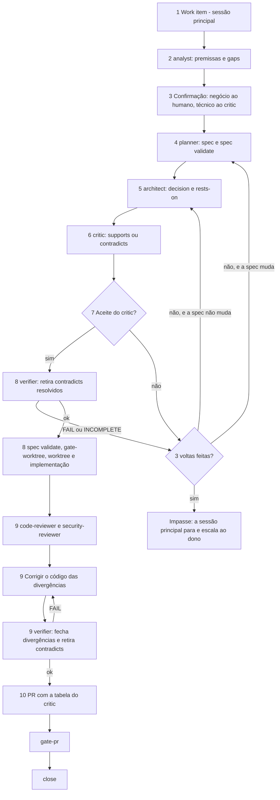

# Fluxo por diretivas e premissas

Vocabulário em [GLOSSARY.md](../GLOSSARY.md). Visão geral e primeiros passos no [README](../README.md). A branch, a marca da `develop` e os checks mecânicos estão em [mechanical-gates.md](mechanical-gates.md).

O humano define diretivas e premissas. O agente escolhe os comportamentos e escreve a spec a partir delas. Este fluxo roda no binário `omhl`, sem o hexlog em TypeScript.

**Estado de ativação.** A ordem da ativação e o que o dono faz a cada mudança estão na seção 10.

## 1. O ciclo

| # | Etapa | Quem | O que acontece |
|---|---|---|---|
| 1 | Premissa | Agente | Grava o work item e sugere premissas (`append`). |
| 2 | Confirmação humana | Humano | Confirma dentro da sessão. O agente grava a premissa com `confirmed_by`, copiando a pergunta e a resposta literais |
| 3 | Gap e divergência | Agente | Dúvida técnica vira `gap`, respondido por uma premissa. Desvio da spec vira `divergence` com `resolution` `open` |
| 4 | Emenda | Agente e humano | Se a spec estava errada, o agente cria `emenda-NN.md` e o humano a aprova. A parte original não muda |
| 5 | Retro | `omhl close` | O agente propõe melhorias, cada uma só vale com a confirmação do humano |
| 6 | Promoção | Agente e humano | O humano confirma |

Ordem do protocolo, antes do código: em `feat` e `fix`, fazer a entrevista de negócio (skill `interview`, seção 12); escolher prefixo, id e slug; gravar o work item (`work-items.<id>`); sugerir as premissas; confirmar com o humano; criar e validar a spec; só então `wt switch -c`.

A tabela descreve o protocolo sem dizer quem o cumpre. Com os agentes do plugin, cada etapa tem um papel `oh-my-hexflow:<papel>` e há uma volta de consenso entre o architect e o critic antes da conferência final da spec: o ciclo de dez passos está na seção 12.

O work item nasce pelo `append` que já existia, sem comando novo.

### A matriz de prefixos

Edição direta na `develop` nunca passa pelo gate.

## 2. Comandos

| Comando | O que faz |
|---|---|
| `omhl hook spec-lock` | Hook `PreToolUse` do Claude Code |
| `omhl hook agent-role` | Hook `PreToolUse` do Claude Code para o `Bash`, o `Monitor` e a tool `Agent` |
| `omhl list --where <campo>=<valor>` | As regras de recusa estão no [ADR 0007](adr/0007-opcoes-da-cli-sao-respeitadas-ou-recusadas.md) |

A interface do agente é a CLI.

Para consultar divergências de um work item:

```bash
omhl list --type divergence --where work_item=work-items.w1 --where resolution=open
```

**Autoria.** Grave tudo pela CLI: `omhl append` (JSON no stdin) e `omhl attest`. O erro seguro é o falso positivo: um humano que roda o `omhl` dentro de uma sessão do Claude Code, ou no terminal integrado de uma IDE, sai registrado como agente.

**Skills do plugin.** A skill [`directives-flow`](../plugin/skills/directives-flow/SKILL.md) leva este fluxo ao agente e cobre também os comandos de consulta ao banco. Os checks mecânicos e o fechamento do work item ficam na skill [`review`](../plugin/skills/review/SKILL.md).

## 3. Confirmação humana (`confirmed_by`)

A confirmação é a aprovação do humano dentro da sessão.

A confirmação é um rastro, não uma prova.

## 4. O arquivo `.omhl/workflow.toml`

| Chave | Efeito |
|---|---|
| `specs.dir` | Pasta das specs, relativa ao diretório principal (e lida do `workflow.toml` dele). O padrão `.omhl/specs` e pastas como `docs/specs` valem |
| `specs.max_lines` | Máximo de linhas de cada parte e de cada emenda. Mínimo `1`. |
| `prefix.<nome>.require` | Átomos exigidos pelo prefixo. |

## 5. O gate de criação da worktree

O agente roda `omhl gate-worktree --branch <nome>` para conferir antes de chamar o `wt`.

| Código | O que tentar |
|---|---|
| `worktree-gate-refused` | Registre e confirme o que `missing` lista, ou escreva e valide a spec. Repita o gate |
| `work-item-not-found`, `work-item-closed` | Grave o work item ou use outra branch. Para reabrir uma fatia antiga, veja os bypasses na seção 10 |
| `prefix-not-allowed` | Corrija o nome. Para uma branch de terceiros, veja os bypasses na seção 10 |
| `main-dir-unknown` | Rode num checkout comum |
| `spec-store-unusable` | Corrija a pasta de spec no diretório principal |
| `invalid-workflow-config` | Corrija o arquivo |

Rode `omhl spec validate` para ver a violação da spec.

### O hook `pre-switch` do `wt`

- O template é POSIX: no `wt` 0.70.0 o hook rodou sob `sh` (observado no spike; a doc do `wt` diz só que ele roda comandos de shell). O `{{ branch }}` vai **sem aspas**: o `wt` já escapa a variável, e as aspas anulam o escape. Com aspas simples, o nome `a$(id)` executa `id`. Sem aspas, nenhum dos 12 nomes perigosos do spike executou nada.
- O `pre-switch` roda antes de a branch e a worktree existirem num `wt switch -c`. Uma saída não zero aborta, e não sobra branch nem diretório.
- Num `wt switch -c`, o `{{ branch }}` é o destino. `^`, `-` e `@` chegam resolvidos. `pr:N` chega literal (observado no `wt` 0.70.0, sem apoio na doc), porque o hook roda antes de o `wt` buscar o PR.
- Instale o `omhl` fora de qualquer worktree (veja `binary-in-worktree` na seção 5 de [mechanical-gates.md](mechanical-gates.md)), senão um `wt remove` o apaga.
- O gate só funciona com o `omhl` no `PATH` do `wt`. Sem ele, todo `wt switch` para uma branch que não seja `develop` nem `main` sai com `127` e o `wt` aborta, inclusive `wt switch -c`. Confira com `command -v omhl` antes de rodar `wt config approvals add`.
- **`wt switch -c` parte da `main`**, a branch padrão, não da `develop`. Para partir da `develop`, passe `--base develop`.

**A aprovação do hook.** O `wt` guarda a aprovação de um comando de projeto pelo projeto e pelo **texto do comando**. Qualquer mudança no texto do comando em `.config/wt.toml` pede uma aprovação nova. Sem aprovação salva e sem terminal interativo, o `wt` aborta todo `wt switch`, inclusive para a `develop`, com `Cannot prompt for approval in non-interactive environment` (saída 1). O `case` do hook não ajuda, porque o `wt` pede a aprovação antes de rodar o hook.

- O dono aprova uma vez, ao ativar, e de novo a cada mudança do texto do comando: `wt config approvals add`.
- `wt config approvals list` confere. O comando sem aprovação aparece como `UNAPPROVED`.
- Se um `wt switch` falhar com `Cannot prompt for approval`, o agente para e pede ao dono o `wt config approvals add`. Ele nunca tenta `--no-hooks`.

### O hook `post-start` do `wt`

O `.config/wt.toml` tem um segundo hook, que grava a marca de congelamento da spec no nascimento da branch:

```toml
[post-start]
omhl-freeze = "case {{ branch }} in develop|main) exit 0;; esac; omhl hook wt-post-start --branch {{ branch }}"
```

- Ele roda **uma vez**, quando a worktree nasce, **em segundo plano**. Uma worktree que já existia, uma branch que já existia e uma branch criada por `git branch` ou `wt switch --no-hooks` não o disparam.
- Ele grava a marca `.frozen` em cada pasta `wi-<id>__*` do work item da branch nova (seção 7). O `omhl hook wt-post-start` é o do `PATH`, com o mesmo cuidado do `pre-switch`: o `{{ branch }}` vai sem aspas e o `case` libera `develop` e `main`.
- A falha é silenciosa: o `wt` não mostra a saída de um hook em segundo plano e não aborta por ele. Se o hook falhar (`omhl` velho, marca não gravável), a branch nasce sem marca. A cura do `spec-lock` é a rede: no primeiro evento de spec ela grava a marca de toda branch `wi-` local que existe (seção 7).
- O comando do hook entra na aprovação do `wt` como o do `pre-switch` (seção 5, "A aprovação do hook"). Um hook `UNAPPROVED` faz o `wt` abortar todo `wt switch` sem terminal interativo. **O agente nunca usa `-y` nem `--no-hooks` diante de um hook `UNAPPROVED`**: ele para e pede ao dono o `wt config approvals add`. O `-y` aprovaria o hook sozinho, e o `--no-hooks` pularia o `pre-switch` junto.

## 6. A spec

### `omhl spec init`

```bash
omhl spec init work-items.w1 export-reports
```

### O formato

Se uma parte passar do limite de tamanho, divida o trabalho em mais partes completas, todas no mesmo work item.

### `omhl spec validate`

```bash
omhl spec validate work-items.w1 --format json
```

## 7. O congelamento

A correção entra como emenda (seção 9).

| Código | O que fazer |
|---|---|
| `spec-frozen` | Registre uma `divergence` e crie a emenda (seção 9) |
| `spec-in-linked-worktree` | Escreva no caminho do diretório principal que a mensagem informa |
| `spec-folder-unknown` | Escreva a emenda na pasta de spec que o work item já tem |

## 8. Gap, divergência e retro

### Gap e a cadeira do dono

```bash
omhl report answers --work-item work-items.w1 --format json
```

### A matriz por papel

| Papel | `commands` | `append.nodes` | `append.relations` | `append.retire` |
|---|---|---|---|---|
| `omhl:analyst` | `append`, `list`, `get`, `render`, `verify`, `byproduct`, `report answers`, `report recurrences`, `report retro`, `help` | `premise`, `gap` | | |
| `omhl:planner` | `spec init`, `spec validate`, `list`, `get`, `render`, `verify`, `byproduct`, `report answers`, `report recurrences`, `report retro`, `help` | | | |
| `omhl:architect` | `append`, `list`, `get`, `render`, `verify`, `byproduct`, `report answers`, `report recurrences`, `report retro`, `help` | `decision` | `rests-on` | |
| `omhl:critic` | `append`, `spec validate`, `list`, `get`, `render`, `verify`, `byproduct`, `report answers`, `report recurrences`, `report retro`, `help` | `decision`, `premise` | `supports`, `contradicts`, `answers`, `rests-on` | |
| `omhl:code-reviewer` | `append`, `list`, `get`, `render`, `verify`, `byproduct`, `report answers`, `report recurrences`, `report retro`, `help` | `divergence`, `decision` | `contradicts`, `rests-on` | |
| `omhl:security-reviewer` | `append`, `list`, `get`, `render`, `verify`, `byproduct`, `report answers`, `report recurrences`, `report retro`, `help` | `divergence`, `decision` | `contradicts`, `rests-on` | |
| `omhl:verifier` | `append`, `spec validate`, `list`, `get`, `render`, `verify`, `byproduct`, `report answers`, `report recurrences`, `report retro`, `help` | `divergence` | | `contradicts` |

Um teste mantém esta tabela igual à matriz compilada no `omhl`.

**Como o papel chega.** O dono retira um `contradicts` (abaixo) só num terminal fora do Claude Code: `! omhl ...` dentro dele grava `claude`.

**Condições finas.** A tabela diz quais tipos; estas regras dizem em que condição:

- Os valores `spec-stale` e `accepted` de `resolution` são respostas do humano.
- `claude` não retira um node que é ponta de um `contradicts` vigente contra uma `decision`: isso fecharia o gate sem tocar na contradição.
- Mudar o `work_item` de um node em `contradicts` vigente é recusado a qualquer autor, porque esconderia a contradição do gate daquele work item.

### Divergência

Quando o agente foge da spec congelada, ele grava uma `divergence`:

| Campo | Valor |
|---|---|
| `source_ref` | O item da spec (`CMP-###` ou `CA-###`) ou o id da diretiva ou premissa |
| `text` | O previsto, o feito e o motivo |
| `work_item` | O work item da divergência |

### A retro

Depois do `close`, o agente propõe uma melhoria por item da retro. Cada proposta é de uma destas categorias, e só vira registro com a confirmação do humano:

- uma diretiva (`guideline`);
- uma premissa (`premise`);
- um ajuste de seção da spec (`spec-section`);
- um novo check, quando o padrão é mecânico. O check vira um arquivo em `.omhl/checks/`, num work item próprio, e o `omhl load` roda antes de qualquer `check run` ([AGENTS.md](../AGENTS.md)).

### A promoção na 3ª ocorrência

```bash
omhl report recurrences --format json
```

O agente sugere a promoção; o humano confirma; só então a `guideline` é gravada, com `confirmed_by`. As premissas de origem ficam como histórico. Antes de registrar uma premissa, o agente roda `omhl report recurrences --min 2` e reaproveita o texto exato de uma premissa anterior que significa a mesma coisa.

## 9. A emenda

Para corrigir um erro da spec depois da aprovação, o agente segue estes passos:

1. Registre uma `divergence` com `resolution` `open` (`omhl append`).
2. Pergunte ao humano se a spec estava errada.
3. Se estava, crie `emenda-NN.md` na pasta da spec do work item, com `Write` de um arquivo novo.
4. Rode `omhl spec validate <work-item>`. Se a emenda for inválida, abandone-a e crie a `emenda-(NN+1).md`. Continue a numeração na emenda seguinte (`EMD-002` depois de `EMD-001`), senão ela cai em `item-id-duplicate`.
5. Mostre a emenda ao humano e peça a aprovação, copiando a pergunta e a resposta literais.
6. Grave uma nova revisão da mesma divergência (append-only, com `base`) com `resolution` `spec-stale`, `amendment` (`emenda-NN`, sem `.md`) e `confirmed_by`.

   O `record_id` da revisão atual vem de `omhl get <id>`.

Nunca tente editar a spec nem procure como descongelá-la.

A `parte-NN.md` original fica intacta. O valor vigente de um item é o da emenda aprovada de maior `NN` que o cita.

## 10. Ativação, bypasses e limites

### Ativação

A ativação seguiu esta ordem, que vale de novo se o texto do comando em `.config/wt.toml` mudar:

1. Compile e reinstale o `omhl` fora de qualquer worktree, num único binário no `PATH`, por exemplo em `~/.local/bin` ([README](../README.md), "Instalação").
2. Rode `omhl hooks install`.
3. Só então versione o `.config/wt.toml` e as entradas `PreToolUse` em `plugin/hooks/hooks.json`: `Edit|Write|MultiEdit` para o `spec-lock` e `Bash|Monitor|Agent|Task` para o `agent-role`.
4. O dono roda `wt config approvals add` e confere com `wt config approvals list` (seção 5), antes de qualquer `wt switch` do agente.
5. Para o hook `post-start`: reinstale o `omhl` no `PATH` (passo 1). O hook chama o subcomando `hook wt-post-start`, e um binário velho sai com `2` em segundo plano, sem marcar nada e sem aviso.
6. O dono roda `wt config approvals add` e confere com `wt config approvals list` que nada aparece `UNAPPROVED`, **antes de qualquer `wt switch`**. O `[post-start]` é um comando novo no `.config/wt.toml`; sem a aprovação e sem terminal interativo, o `wt` aborta todo `wt switch`, inclusive para a `develop`.

Depois de puxar mudanças, recompile e reinstale o `omhl` do `PATH` antes de usar o plugin. Com um `omhl` velho, o congelamento fica sem efeito até a reinstalação. O mesmo vale para o binário ausente (saída `127`).

### Bypasses do gate

O gate é um freio, não uma parede. Estes caminhos o contornam:

- `wt switch -c --no-hooks`. O `-y` não é bypass: ele roda o hook.
- A aprovação do hook de projeto recusada num terminal interativo. O `wt` segue sem o hook. Sem terminal, a falta de aprovação aborta em vez de liberar (seção 5).
- `git switch -c` e `git branch`. Nenhum guard os barra.
- Worktrees criadas antes do `.config/wt.toml`, que não leem o hook.

Para reabrir uma fatia antiga ou entrar numa branch de terceiros, a saída documentada é `wt switch --no-hooks`, decisão do dono e nunca do agente.

O dono aceitou estes bypasses nesta entrega. Nenhum reforço entra agora.

### Limites

- Numa worktree destacada (sem branch), o `{{ branch }}` do `.config/wt.toml` fica indefinido, segundo a doc do `wt`.
- Uma `divergence` aberta não bloqueia o `omhl gate-pr` nem o `omhl close`: o gate não pergunta por divergência. Aceito para a v1; revisar com os dados do piloto.
- Uma violação de diretiva não bloqueia o PR. A tabela do PR a lista quando o code-reviewer ou o security-reviewer a gravam como `decision` com `contradicts` vigente (skill `review`, passo 7), com o autor marcado; a violação que nenhum revisor grava só a leitura do PR pelo dono cobre. Aceito para a v1; reavaliar no piloto.
- A razão de uma retirada de `contradicts` pelo verifier não fica no grafo. A razão fica na mensagem dele e na coluna de evidência da tabela do PR.
- O hook `agent-role` protege contra o erro do agente, não contra a má-fé.
- A spec vive no diretório principal, fora do git. Ela não vai com um clone e some com o diretório.
- Uma branch `wi-` criada fora do `wt` (`git branch`, `git switch -c`, `wt switch --no-hooks`) não dispara o `post-start`. Se for apagada sem nenhum evento de spec no meio, também não deixa marca: é o residual do congelamento.
- O hook decide no instante da checagem. Se o alvo de um link simbólico mudar depois dela e antes da escrita (TOCTOU), o hook não detecta a troca.
- O `spec-lock` acha o checkout pela raiz do `.omhl.toml`, não pela pasta do arquivo. Numa worktree ligada aninhada dentro do diretório principal e sem `.omhl.toml` próprio (branch anterior ao marcador), o marcador achado é o do principal, `linked_worktree` sai falso e o `spec-in-linked-worktree` não dispara. O fluxo do `wt` cria worktrees irmãs, então isso não acontece nele.

## 11. Diretivas: `kind`, âncora e retirada

### O `kind` da diretiva

**Migração.** Se um arquivo de `.omhl/guidelines/` não tem `kind`, acrescente `kind = "business"` ou `kind = "architecture"` ao arquivo e rode o `omhl load` de novo.

### A relação `rests-on`

`rests-on` diz em que um node se apoia.

`rests-on` e `supports` são relações distintas, em direções opostas.

### `omhl guideline retire`

**Antes de retirar:** a retirada é definitiva e vale para todos os clones e branches, porque o banco é do usuário e é append-only. Retire só depois de a remoção do arquivo estar mergeada; numa branch anterior à diretiva, faça rebase sobre a `main` em vez de retirar. Retirar uma diretiva em que decisões se apoiam é aceito, e as decisões que só tinham esse apoio passam a reprovar `decisions-anchored` até ganharem outro.

## 12. O ciclo com os agentes

O ciclo abaixo é o da seção 1 com os papéis nomeados e a volta de consenso. A sessão principal chama um agente por vez, como `oh-my-hexflow:<papel>`.

**Antes do passo 1.** Em `feat` e `fix`, a sessão principal conduz a entrevista de negócio com o dono (skill [`interview`](../plugin/skills/interview/SKILL.md)): rodadas de perguntas até a ambiguidade chegar a 20% ou menos, e só então o passo 1 grava o work item e as premissas de negócio confirmadas. Nos outros prefixos a entrevista só roda a pedido do dono. O estado das rodadas fica em `.omhl/notes/`, fora do banco e fora da spec.

**Caminho leve (`chore` e `docs`).** Não há spec: o consenso fica nos passos 2 e 3 (o critic só no modo do passo 3), sem planner nem voltas e sem os passos 4 a 7, e o passo 8 se reduz ao `omhl gate-worktree`.

**O ciclo como dado e a vista por papel.** O [`cycle.md`](../plugin/skills/directives-flow/references/cycle.md) traz, além da prosa dos dez passos, um bloco `omhl-cycle` com o número, o nome e os papéis de cada passo; um teste confere que o bloco e a prosa concordam. Cada agente pré-carrega a skill `role-<papel>` pelo campo `skills:`, que lista os comandos `omhl` do papel por passo, e as páginas de comando de `directives-flow/references/` e `review/references/` abrem com a tabela de quem roda o comando e em qual passo. As três skills de CLI antigas (consulta, checks e fechamento) foram dissolvidas nessas duas skills. A decisão, as medições do canal `skills:` e os limites estão no [ADR 0011](adr/0011-skills-por-papel-e-entrevista-antes-do-work-item.md).

### Os dez passos

1. **Work item.** A sessão principal grava `work-items.<id>` com `omhl append`, com o prefixo e o slug escolhidos.
2. **Analyst.**
3. **Confirmação.** O que é de negócio vai ao humano, que confirma dentro da sessão.
4. **Planner.**
5. **Architect.**
6. **Critic.**
7. **Consenso.** A volta 1 são os passos 5 e 6; sem aceite, o architect (e o planner, se a spec muda) revê e o critic julga de novo, em **no máximo 3 voltas** no total. O aceite é o veredito `ACCEPT`; `ACCEPT-WITH-RESERVATIONS` vai ao dono com as reservas. Na terceira volta sem aceite, a sessão principal para e mostra o impasse ao dono. Os `contradicts` seguem vigentes: o dono os retira num terminal fora do Claude Code, ou manda revisar e o verifier os retira. O veredito do critic circula só na mensagem entre os agentes e não vai ao grafo.
8. **Spec e worktree.** Com o aceite, o `oh-my-hexflow:verifier` retira os `contradicts` resolvidos; um `FAIL` ou `INCOMPLETE` dele conta como volta sem aceite. Então vêm a conferência final com `omhl spec validate`, o `omhl gate-worktree`, a worktree e a implementação.
9. **Revisão.** A sessão principal corrige o código das divergências abertas; um desvio que o dono aceita não é correção, e só a resposta dele grava `accepted`.
10. **PR e fechamento.** O PR leva no corpo a tabela das decisões do critic; depois vêm `omhl gate-pr` e `omhl close`, pela skill [`review`](../plugin/skills/review/SKILL.md), passo 8.



`ACCEPT-WITH-RESERVATIONS` fica fora do diagrama: vai ao dono com as reservas, e ele decide.

### O que cada passo grava

- A sessão principal grava o que couber a ela, por exemplo um gap para cada pergunta em aberto.

### O hook `agent-role`

- **A chamada com `name` a um agente do plugin.** Com `name` na chamada da tool `Agent`, o Claude Code não pré-carrega a skill declarada em `skills:` do agente, e ele começaria sem a vista do seu papel; por isso o hook nega essa chamada.
- **O que o agente portado roda.** O arquivo `plugin/agents/<papel>.md` traz no frontmatter o `omhl-allow` com os comandos do papel. Com o `allow`, o Claude Code pula o prompt de permissão desse comando nos modos `default` e `auto`, salvo regra `deny` ou `ask` das configurações do dono e as ações que nenhum modo aprova ([doc de hooks do Claude Code, "PreToolUse decision control"](https://code.claude.com/docs/en/hooks)).
- **A matriz tem três cópias que um teste mantém iguais:** a matriz compilada no `omhl` (`nodes`, `relations`, `retire`, com as condições finas do `append`), o `omhl-allow` de cada agente (`commands` e as listas do `append`) e a tabela única de `docs/directives-flow.md` (seção 8). A decisão e o limite estão no [ADR 0008](adr/0008-papel-do-agente-imposto-por-hook-e-matriz.md).
